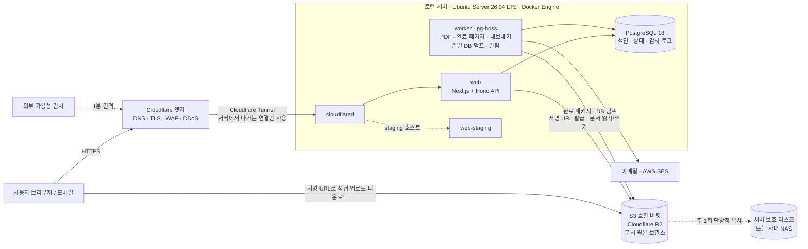
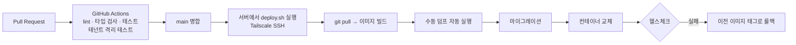

# 4mERP 배포 계획서

| 항목 | 내용 |
|---|---|
| 문서 버전 | v0.4 |
| 작성일 | 2026-10-03 |
| 변경 이력 | v0.4 — **VPS 대신 로컬(사내) 서버 + Cloudflare Tunnel**로 변경. Caddy 제거, 서버에서 직접 이미지 빌드, 스테이징을 같은 서버에 구성. v0.3 — 웹·API 단일 컨테이너. v0.2 — 사용자 100명 이하, S3 문서 원본 보관소 + DB 일일 자동·수동 덤프 |
| 관련 문서 | [PRD](./PRD.md) · [TECH_SPEC](./TECH_SPEC.md) |
| 가격 기준 | 2026년 10월 조사 기준 추정치입니다. 구매·계약 전에 다시 확인하세요. |

---

## 1. 결론 요약

> **로컬 서버 1대(Ubuntu Server 26.04 LTS + Docker Engine)에서 Docker Compose로 컨테이너를 실행하고, Cloudflare Tunnel로만 외부 사용자 접근을 허용합니다.**
> 문서·첨부·DB 덤프는 서버 밖의 S3 호환 버킷(Cloudflare R2 등)에 저장합니다.
> **예상 비용: 장비 구입 약 80~150만 원(1회) + 월 약 1만 원 안팎**

이 구성의 장점은 다음과 같습니다.
1. **공인 IP·포트 개방이 필요 없습니다.** Tunnel은 서버에서 Cloudflare로 나가는 연결만 사용합니다. 공유기 포트포워딩 없이 동적 IP 환경에서도 동작하고, 서버가 인터넷에 직접 노출되지 않습니다.
2. **월 고정비가 거의 없습니다.** VPS 월 $22~30 대신 전기료와 도메인 비용만 듭니다.
3. **데이터를 직접 통제합니다.** DB가 사내 장비에 있고, 버킷의 로컬 사본도 같은 서버나 사내 NAS에 둘 수 있습니다.

대신 **정전, 인터넷 회선 장애, 하드웨어 고장**을 직접 감당해야 합니다. 그래서 UPS, 자동 재시작, 외부 가용성 감시, 예비 장비로 복구하는 절차를 함께 갖춥니다(4·8·9장).
컨테이너 기반이므로 나중에 VPS나 클라우드로 옮길 때는 같은 Compose 파일을 다른 장비에서 실행하면 됩니다.

---

## 2. 데이터 보관 원칙

| 데이터 | 원본 위치 | 보호 방식 | 장애 시 손실 범위 |
|---|---|---|---|
| **완료 문서 패키지** (PDF, 본문 JSON, 결재 이력 JSON, 첨부) | S3 버킷 (서버 밖) | 키를 덮어쓰지 않음(write-once) + 버킷 보호 기능 | **없음** (완료 즉시 저장) |
| 작성 중·진행 중 문서 본문, 첨부 | S3 버킷 (서버 밖) | 저장할 때마다 새 리비전 키로 기록 | 없음 |
| 조직, 사용자, 결재 진행 상태, 검색용 정보, 감사 로그 | PostgreSQL (로컬 서버) | **매일 자동 덤프 → S3**, 필요할 때 관리자 수동 덤프 | **최대 24시간** |
| 설정·시크릿 | git 저장소 (sops로 암호화) + 서버의 `.env` | 변경할 때마다 커밋 | 없음 |

- **DB는 색인 역할입니다.** 완료된 문서는 DB가 없어도 S3 패키지만으로 열람할 수 있고, 결재 사실(누가·언제·어떤 결재선)을 증명할 수 있습니다.
- **버킷은 반드시 서버 밖에 둡니다.** 로컬 서버의 디스크가 고장 나거나 장비를 도난당해도 문서는 남아야 하기 때문입니다.
- 브라우저의 첨부 업로드·다운로드는 **서명 URL로 버킷과 직접** 주고받습니다. 대용량 파일이 사내 회선과 Tunnel을 거치지 않습니다.

### 2.1 S3 버킷 구조
```
s3://4merp-{env}/
 ├─ docs/{계정ID}/{사업자코드}/{YYYY}/{문서ID}/
 │   ├─ revisions/{n}.json          ← 작성 중 저장본 (덮어쓰지 않고 n 증가)
 │   ├─ attachments/{파일ID}_{원본파일명}
 │   ├─ final/                       ← 결재 완료 시 1회만 생성 (write-once)
 │       ├─ document.pdf             ← 결재란이 찍힌 최종본
 │       ├─ document.json            ← 양식 데이터 원본
 │       ├─ approval.json            ← 결재선, 처리자·대결 여부·일시·IP·의견, 파일별 SHA-256
 │       └─ manifest.json            ← 패키지 내 파일 목록 + 해시 (마지막에 쓰며, 있으면 패키지 완성)
 │   └─ post-approvals/{단계ID}.json ← 완료 이후의 후결 승인 기록 (건별 1회만 생성)
 ├─ _staging/{계정ID}/{업로드ID}     ← 첨부 업로드 직후 검증 전 객체 (등록되지 않으면 1일 후 자동 삭제)
 ├─ exports/{계정ID}/{작업ID}.zip    ← 관리자 내보내기 결과 (7일 후 자동 삭제)
 └─ _system/db-dumps/
     ├─ daily/{YYYY-MM-DD}.dump      ← 자동 덤프 (최근 7개)
     ├─ weekly/{YYYY-Www}.dump       ← 일요일 덤프 (최근 4개)
     └─ manual/{YYYY-MM-DDTHHmm}_{요청자}.dump  ← 수동 덤프 (관리자가 삭제할 때까지)
```

### 2.2 버킷 보호
- 애플리케이션에는 **삭제 권한이 없는 키**를 줍니다(읽기·쓰기만). 덤프 정리는 버킷 수명 주기 규칙(lifecycle)으로 처리합니다.
- 수명 주기 규칙에 **`_staging/` 접두어 1일 후 삭제**를 포함합니다(M4 첨부: 검증을 통과하지 못했거나 등록되지 않은 업로드). 로컬 SeaweedFS에는 이 규칙이 없다.
- 첨부 업로드 서명 URL은 `Content-Length`를 서명에 고정합니다. S3·R2는 다른 크기의 본문을 거부하지만 로컬 SeaweedFS는 강제하지 않으므로, 서버가 업로드 뒤 실제 크기를 다시 확인합니다(ADR 0008).
- `final/` 경로에는 공급자의 버전 관리 또는 보존 잠금(Object Lock / Bucket Lock) 기능을 적용해, 보존연한 안에는 지워지지 않게 합니다.

### 2.3 버킷 공급자
| 공급자 | 비용 (100명 1년 차 약 15GB) | 장점 | 고려 사항 |
|---|---|---|---|
| **Cloudflare R2** (기본 권장) | 월 $0.3 미만 (10GB 무료) | 외부 전송 무료, Tunnel과 같은 Cloudflare 계정에서 관리 | 데이터가 국내에 있다는 보장은 없음 |
| AWS S3 서울 | 월 $0.5 미만 | 국내 보관 | 외부 전송 요금 (이관 시) |
| NCP Object Storage | 소액 | 국내 보관, 국내 사업자 | – |

국내 보관이 필수라면 AWS S3 서울 또는 NCP를 씁니다(PRD 오픈 이슈 Q4).

---

## 3. 아키텍처



### 3.1 요청 흐름
1. 사용자는 `https://erp.<도메인>`으로 접속합니다. Cloudflare가 TLS를 처리합니다.
2. Cloudflare는 Tunnel을 통해 서버의 `cloudflared` 컨테이너로 요청을 넘깁니다.
3. `cloudflared`는 Docker 내부 네트워크로 `web:3000`에 전달합니다. **서버에는 외부에 공개된 포트가 하나도 없습니다.**
4. 첨부 파일은 web이 발급한 서명 URL로 브라우저와 버킷이 직접 주고받습니다.

### 3.2 검토한 대안
| 기준 | **로컬 서버 + Tunnel (채택)** | 서울 VPS | 서버리스 (Workers + Supabase) |
|---|---|---|---|
| 월 비용 | **약 1만 원** (+ 장비 1회 구입) | 약 3~4만 원 | 약 5~6만 원 |
| 공인 IP·포트 개방 | **불필요** | 필요 (또는 Tunnel) | 불필요 |
| 데이터 통제 | **사내 보관** | 클라우드 | 벤더 종속 |
| 가용성 | 정전·회선·하드웨어를 직접 관리 | 데이터센터 수준 | 높음 |
| 하드웨어 고장 대응 | 예비 장비로 복구 (9장) | 공급자가 처리 | 공급자가 처리 |
| 이전 용이성 | 같은 Compose 파일로 VPS 이전 가능 | – | 재작성 필요 |

---

## 4. 서버 하드웨어 · OS

### 4.1 권장 사양 (사용자 100명 이하)
| 항목 | 권장 | 최소 | 이유 |
|---|---|---|---|
| CPU | 6코어 이상 x86_64 (Ryzen 5 / Core i5급 미니 PC) | 4코어 (Intel N150급) | PDF 생성(Chromium)과 스테이징 동시 실행 |
| 메모리 | **16GB** | 8GB | 운영 + 스테이징 + Chromium |
| 주 디스크 | NVMe SSD 512GB | 256GB | OS, Docker 이미지, PostgreSQL |
| 보조 디스크 | 1TB (내장 SSD·HDD 또는 사내 NAS) | – | 버킷 로컬 사본, 덤프 보관 (8.5절) |
| 네트워크 | 유선 기가비트, **기업용 인터넷 회선** | – | 가정용 회선은 약관상 서버 운영이 제한될 수 있음 (통신사 약관 확인 필요) |
| 전원 | **UPS 600VA 이상 (USB 연동)** | – | 정전 시 안전 종료(NUT), 순간 정전 흡수 |
| BIOS 설정 | 정전 후 전원 복구 시 자동 켜짐 | – | 무인 재시작 |

### 4.2 OS와 기본 구성
- **Ubuntu Server 26.04 LTS** (26.04.1, 지원 기간 2031-05까지). Docker Engine 공식 저장소가 지원합니다.
- **Docker Engine + Compose 플러그인** (Docker Desktop이 아님). 리눅스용 Docker Engine은 무료이고 서버 용도에 맞습니다.
- 시간 동기화(systemd-timesyncd), 자동 보안 업데이트(unattended-upgrades, 새벽 4~5시 재부팅 창)
- Docker 서비스 자동 시작, 모든 컨테이너는 `restart: unless-stopped`
- **디스크 암호화(권장):** LUKS + TPM 자동 잠금 해제(Clevis). 장비를 도난당해도 DB를 읽을 수 없게 하면서 무인 재부팅도 가능합니다.

### 4.3 용량 추정 (100명 기준)
| 항목 | 1년 차 | 5년 누적 |
|---|---|---|
| S3 문서·첨부 | 약 15GB | 약 75GB |
| DB 실제 크기 (인덱스 포함) | 약 1GB | 약 5GB |
| DB 덤프 1개 (압축) | 50~150MB | 1GB 미만 |
| 서버 디스크 (OS + 이미지 + DB + 로그) | 약 60GB | 약 100GB |

---

## 5. 비용

| 구분 | 항목 | 비용 (추정) |
|---|---|---|
| **1회** | 미니 PC (6코어, 16GB, 512GB NVMe) | 약 60~110만 원 |
| | UPS 600~1000VA | 약 10~25만 원 |
| | 보조 디스크 1TB (NAS가 없을 때) | 약 8~15만 원 |
| | **합계** | **약 80~150만 원** |
| **월** | 전기료 (평균 20~35W 상시 가동) | 약 3~6천 원 |
| | 도메인 (.com·.kr, 연간 비용 월할) | 약 1.5~2.5천 원 |
| | Cloudflare (DNS, Tunnel, WAF, Access 50명까지) | 0원 (무료 플랜) |
| | S3 버킷 (R2, 15~30GB) | 0~700원 |
| | 이메일 (AWS SES, 월 수천 건) | 0~1,400원 |
| | 모니터링 (무료 플랜) | 0원 |
| | **합계** | **약 5천~1만 원** |

인터넷 회선 비용은 기존 사내 회선을 쓴다는 전제로 제외했습니다. 서버 전용으로 기업용 회선을 새로 계약하면 월 회선 비용이 추가됩니다.

---

## 6. 컨테이너 구성

### 6.1 기술 스택 (배포 관점)
확정 버전은 [TECH_SPEC.md](./TECH_SPEC.md)를 따릅니다.

| 영역 | 선택 | 배포 관점의 이유 |
|---|---|---|
| 호스트 | Ubuntu Server 26.04 LTS + Docker Engine | 무료, 장기 지원 |
| 웹 + API | Next.js 16.3 + Hono 4.13 (`/api/*`) | 컨테이너 1개 |
| DB | PostgreSQL 18 | `ltree`, `pg_trgm` |
| 작업 큐 | pg-boss 12 | Redis 불필요 |
| PDF | Playwright 1.63 (worker, 한글 폰트 포함) | |
| 외부 연결 | **cloudflared (Tunnel)** | TLS·라우팅을 Cloudflare가 처리하므로 **별도 리버스 프록시(Caddy) 불필요** |
| 이메일 | AWS SES | |

### 6.2 Docker Compose 서비스 (운영, 메모리 16GB 기준)
| 서비스 | 이미지 | 역할 | 메모리 상한 |
|---|---|---|---|
| `cloudflared` | `cloudflare/cloudflared:2026.9.3` (버전 고정) | Tunnel 연결, 호스트 이름별로 web·web-staging에 전달 | 128MB |
| `web` | 서버에서 빌드 (`node:24-bookworm-slim` 기반) | Next.js UI + Hono API, 인증, 서명 URL 발급 | 1GB |
| `worker` | 서버에서 빌드 (`mcr.microsoft.com/playwright:v1.63.0-noble` + postgresql-client-18 + age) | PDF·패키지, 내보내기, DB 덤프, 알림, 예약 작업 | 2GB |
| `postgres` | `postgres:18-bookworm` | DB | 4GB |
| `migrate` | 서버에서 빌드 (1회 실행) | 배포 시 drizzle-kit 마이그레이션 | – |

**네트워크 규칙**
- 운영 Compose 파일에는 `ports:`를 **두지 않습니다.** 외부 접근은 cloudflared만 내부 네트워크로 합니다. Docker가 공개한 포트는 호스트 방화벽(ufw)을 우회하기 때문입니다.
- 네트워크를 둘로 나눕니다: `edge`(cloudflared ↔ web), `internal`(web·worker ↔ postgres). cloudflared는 DB에 닿을 수 없습니다.

### 6.3 환경 구성
| 환경 | 위치 | 접근 | 데이터 |
|---|---|---|---|
| 로컬 개발 | 개발자 PC (Docker Desktop 또는 WSL2) | localhost | 시드 데이터 |
| **스테이징** | **같은 서버**의 별도 Compose 프로젝트(`fmerp-staging`), 별도 DB·버킷 | `staging.<도메인>` + **Cloudflare Access**(허용한 이메일만) | 익명화 샘플 + 복구 리허설 |
| 운영 | 로컬 서버 (`fmerp-prod`) | `erp.<도메인>` | 실제 데이터 |

스테이징은 메모리 상한(합계 3GB)을 걸어 운영에 영향을 주지 않게 하고, 쓰지 않을 때는 내려 둡니다.

---

## 7. Cloudflare 구성

| 항목 | 설정 |
|---|---|
| 도메인 | Cloudflare DNS로 관리 (네임서버 이전) |
| Tunnel | 대시보드에서 관리하는 Tunnel 1개. 토큰은 서버 `.env`에만 보관하고 git에는 넣지 않음 |
| 공개 호스트 이름 | `erp.<도메인>` → `http://web:3000`, `staging.<도메인>` → `http://web-staging:3000` |
| Cloudflare Access (Zero Trust 무료, 50명까지) | `staging.<도메인>`, 관리용 경로에 이메일 OTP 또는 Google 로그인 요구. 운영 앱 본체는 앱 자체 인증을 사용 |
| SSL/TLS | Full 모드, 항상 HTTPS, HSTS |
| 보안 | WAF 관리형 규칙(무료 범위), Bot Fight Mode, 로그인·PIN API 속도 제한 규칙 |
| 캐시 | Next 정적 자원(`/_next/static/*`)만 캐시, API·HTML은 캐시 제외 |

### 7.1 Cloudflare 무료 플랜 제약과 설계 반영
| 제약 | 영향 | 설계 반영 |
|---|---|---|
| **요청 본문 최대 100MB** (초과 시 413) | Tunnel을 거치는 업로드 크기 제한 | 첨부는 서명 URL로 버킷에 직접 업로드하므로 Tunnel을 거치지 않음. 파일당 50MB 정책(APV-013)도 한도 안 |
| **응답 대기 최대 100초** (초과 시 524) | 오래 걸리는 API 응답 실패 | PDF·내보내기·덤프는 모두 worker 비동기 작업으로 처리하고 API는 즉시 응답. 실시간 알림(SSE)은 30초마다 heartbeat 전송 |
| 연결 단위 처리 | Tunnel이나 cloudflared가 끊기면 서비스가 중단됨 | `restart: unless-stopped`, 외부 가용성 감시로 즉시 알림 |

---

## 8. 백업 · 복구 · 이관

### 8.1 DB 덤프
| 구분 | 실행 | 보관 | 저장 위치 |
|---|---|---|---|
| **자동 일일 덤프** | 매일 03:00 KST, worker 예약 작업. 직전 덤프 이후 변경이 없으면 건너뜀 | 일 7개 + 주 4개 | `_system/db-dumps/daily`, `weekly` |
| **관리자 수동 덤프** | 관리 콘솔 버튼(재인증 필요), 운영 배포 직전 자동 실행 | 관리자가 삭제할 때까지 | `_system/db-dumps/manual` |

- 형식은 `pg_dump -Fc`이고, age로 암호화한 뒤 업로드합니다. 복호화 키는 서버와 분리해 비밀번호 관리자에 2부 보관합니다.
- 덤프 해시·크기는 `backup_job`에 기록합니다. 실패하거나 03:30까지 성공 신호가 없으면 관리자에게 알립니다.

### 8.2 복구 목표
| 지표 | 목표 | 근거 |
|---|---|---|
| RPO (완료 문서) | 0 | 완료 즉시 서버 밖 S3에 저장 |
| RPO (DB) | ≤ 24시간 | 일일 덤프 |
| RTO (서비스·컨테이너 장애) | ≤ 30분 | 컨테이너 자동 재시작, 원격 접속으로 조치 |
| RTO (서버 하드웨어 고장) | ≤ 4시간 | **예비 장비**(개발 PC 포함)에서 아래 절차로 복구 |
| RTO (정전·회선 장애) | 복구 시점까지 | UPS로 짧은 정전 흡수, 회선 장애는 통신사 복구에 의존 (10장 리스크) |

### 8.3 복구 절차 (서버 하드웨어 고장)
1. 예비 장비(또는 개발 PC)에 Docker를 설치합니다.
2. git 저장소에서 Compose 파일과 암호화된 `.env`를 받아 복호화합니다.
3. S3에서 최신 덤프를 받아 `pg_restore`로 복원합니다.
4. 같은 S3 버킷을 바라보도록 설정합니다 (문서는 이동할 필요 없음).
5. **같은 Tunnel 토큰으로 cloudflared를 실행합니다.** DNS 변경 없이 그 장비로 트래픽이 연결됩니다.
6. 마지막 덤프 이후 완료된 문서는 S3 `final/` 패키지에서 **색인 재구성 스크립트**로 DB에 다시 등록합니다.

> 5단계 덕분에 IP나 DNS를 바꿀 필요가 없습니다. 원래 서버의 cloudflared는 반드시 꺼서 두 장비가 동시에 연결되지 않게 합니다.

### 8.4 이관 (다른 서버·VPS·서비스로)
| 방법 | 절차 | 대상 |
|---|---|---|
| **전체 이관** | ① 관리자 수동 덤프 → ② `rclone sync`로 버킷 복사 → ③ 대상 장비에서 같은 Compose로 기동, `pg_restore` → ④ Tunnel 토큰 이전 | 장비 교체, VPS·클라우드 이전 |
| **문서만 보관** | 버킷의 `docs/**/final/`만 복사 | 서비스 종료 후 보관 |
| **계정 단위 내보내기 (UI)** | 관리 콘솔에서 요청 → ZIP 생성 → 서명 URL로 다운로드 | 계정 관리자 직접 (PRD BAK-009) |

### 8.5 로컬 2차 사본
- 서버의 보조 디스크(또는 사내 NAS)에 **주 1회** 버킷을 단방향으로 복사합니다(`rclone copy`, 삭제는 동기화하지 않음). 읽기 전용 버킷 키를 사용합니다.
- 버킷 공급자 장애나 키 유출에 대비한 사본이며, 사내에 문서 전체가 남는 "로컬 저장"의 가장 단순한 형태입니다.
- 보조 디스크가 서버 본체와 같은 장비면 화재·도난에는 대비되지 않습니다. 이 위험은 서버 밖 버킷이 담당합니다.

### 8.6 복구 리허설
분기 1회, 스테이징 또는 예비 장비에서 8.3 절차를 실행합니다. 다음을 확인하고 결과를 기록합니다.
- 문서 수 일치
- 무작위 패키지 20건의 해시 검증
- 로그인과 결재 처리 동작

---

## 9. 보안 · 운영

### 9.1 서버 보안
- **공유기:** 포트포워딩 없음, UPnP 끔. 서버는 사내망에서도 고정 IP(DHCP 예약)를 받습니다.
- **호스트 방화벽(ufw):** 인바운드 전면 차단. 예외는 관리용 원격 접속(9.2)뿐입니다.
- **SSH:** 키 인증만 허용, root 로그인 금지.
- **컨테이너:** non-root 실행, 이미지 버전 고정, `ports:` 미사용(6.2), DB는 `internal` 네트워크에만 연결.
- **DB 계정:** 앱 계정과 마이그레이션 계정 분리. 감사 로그 테이블은 앱 계정에 INSERT·SELECT만 허용.
- **S3 키:** 앱용(읽기·쓰기, 삭제 불가), 로컬 사본용(읽기 전용), 관리용(수명 주기·삭제)을 분리합니다. 관리용 키는 서버에 두지 않습니다.
- **물리 보안:** 잠금 가능한 공간에 두고, BIOS 비밀번호를 설정하고, 디스크를 암호화합니다(4.2).

### 9.2 원격 관리
| 방법 | 용도 | 비고 |
|---|---|---|
| **Tailscale** (권장) | 관리자 SSH, 긴급 조치 | 무료 개인 플랜. 인바운드 포트 개방 없이 사설망으로 접속 |
| Cloudflare Access + SSH | 대안 | 브라우저 기반 SSH 가능 |
| 사내 LAN 직접 접속 | 사무실 안에서 작업 | – |

### 9.3 모니터링 · 알림
| 항목 | 도구 | 알림 기준 |
|---|---|---|
| **외부 가용성** | Better Stack 무료 플랜 또는 UptimeRobot — 공개 URL(`/api/health`)을 1분 간격으로 확인 | 2회 연속 실패 (정전·회선·Tunnel 장애 감지) |
| 에러 | Sentry 무료 플랜 | 신규 에러, 에러율 급증 |
| 리소스 | node_exporter → Grafana Cloud 무료 플랜 | CPU 80%, 메모리 85%, 디스크 70% |
| 일일 덤프 | healthchecks.io heartbeat | 03:30까지 성공 신호 없음 |
| UPS | NUT | 배터리 전환 시 알림, 잔량 30%에서 안전 종료 |
| 디스크 상태 | smartmontools | SMART 경고 |

### 9.4 배포 절차

- **이미지는 서버에서 직접 빌드합니다.** GitHub 무료 플랜의 비공개 패키지 저장 용량이 작아(약 500MB) Playwright가 포함된 worker 이미지(수 GB)를 레지스트리에 올리기 어렵기 때문입니다.
- 빌드한 이미지에는 git 커밋 해시를 태그로 붙이고, 직전 2개 버전을 남겨 롤백에 씁니다.
- 서버의 git 접근은 **읽기 전용 배포 키**를 씁니다.
- 스테이징에 먼저 배포해 확인한 뒤 운영에 배포합니다.
- 자동 배포가 필요해지면 서버에 GitHub Actions self-hosted runner를 두는 방식을 검토합니다(나가는 연결만 사용).

---

## 10. 단계별 실행 계획

| 단계 | 시점 | 작업 |
|---|---|---|
| 1 | M0 (골격) | 로컬 개발 Compose, CI |
| 2 | M1 전 | 도메인 구입·Cloudflare DNS 이전, Google·Naver OAuth 앱 등록 |
| 3 | M5 전 | **서버 장비·UPS 구입**, Ubuntu·Docker 설치, 디스크 암호화, Tailscale, Tunnel 생성, 버킷 생성(앱·사본·관리 키 분리) |
| 4 | M5~M7 | 스테이징 구축(Access 보호), 일일 덤프·수명 주기 규칙·heartbeat, 색인 재구성 스크립트 |
| 5 | M8 (출시 전) | 운영 구축, 외부 가용성 감시·UPS 연동, **첫 복구 리허설(예비 장비)**, 이관 리허설, 부하 테스트(동시 30명), 보안 점검, 네이버 로그인 검수 |
| 6 | 운영 중 | 분기별 복구 리허설, 반기별 장비·용량 점검 |
| 7 | 필요 시 | 가용성 요구가 커지면 같은 Compose로 VPS·클라우드 이전 또는 예비 장비 상시 대기 |

---

## 11. 리스크와 대응

| 리스크 | 영향 | 대응 |
|---|---|---|
| **정전** | 서비스 중단 | UPS로 짧은 정전 흡수. 장시간 정전이면 NUT로 안전 종료, 전원 복구 시 자동 기동 |
| **인터넷 회선 장애** | 외부 접속 불가 | 외부 가용성 감시로 즉시 인지. 회선 이중화(LTE·5G 라우터 백업 회선)는 필요 시 추가 |
| **서버 하드웨어 고장** | 서비스 중단, 최대 24시간 DB 변경분 손실 | 완료 문서는 S3에 있어 손실 없음. 예비 장비로 4시간 안에 복구(8.3) |
| 디스크 고장 | DB 손실 | SMART 감시, 일일 덤프, 색인 재구성 |
| 장비 도난·물리 접근 | 개인정보 유출 | 디스크 암호화, 잠금 공간, BIOS 비밀번호 |
| 가정용 회선 약관 | 서버 운영 제한 | 기업용 회선 사용 (통신사 약관 확인) |
| Cloudflare 무료 플랜 제약 (100MB, 100초) | 대용량 요청·장시간 응답 실패 | 서명 URL 직접 업로드, 비동기 작업 처리 (7.1) |
| Cloudflare 장애·정책 변경 | 외부 접속 불가 (OAuth 로그인도 도메인에 묶여 있어 우회 접속 불가) | 짧은 장애는 감수하고 상태를 공지. 장기화·정책 변경 시 같은 도메인을 다른 터널·VPS로 옮기는 절차를 Runbook에 준비 |
| 일일 덤프가 조용히 실패 | 복구 시점이 오래됨 | heartbeat 알림 |
| 운영자 1인 의존 | 대응 지연 | Runbook 문서화, 알림 수신자 2명 이상, 원격 관리 경로 확보 |

---

## 12. 참고 자료
- Cloudflare 무료 플랜 요청 본문 100MB·응답 대기 100초 제한: [Cloudflare Community](https://community.cloudflare.com/t/when-we-import-a-file-we-get-timeout-error/763524)
- Docker Engine Ubuntu 지원: download.docker.com 저장소에 `resolute`(26.04) 배포판 확인 (2026-10-03)
- Ubuntu 26.04 LTS 지원 기간: endoflife.date (26.04.1, 2031-05까지)
- cloudflared 최신 버전: Docker Hub `cloudflare/cloudflared:2026.9.3` (2026-09-24)
