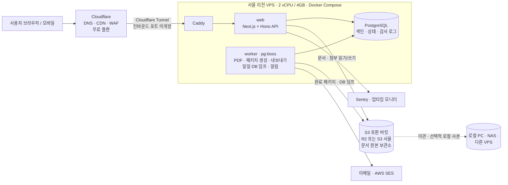
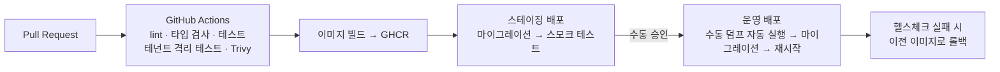

# 4mERP 배포 계획서

| 항목 | 내용 |
|---|---|
| 문서 버전 | v0.3 |
| 작성일 | 2026-10-03 |
| 변경 이력 | v0.3 — 기술 스택 확정에 맞춰 6장 갱신(웹·API 단일 컨테이너). v0.2 — 목표 사용자 100명 이하로 확정. 연속 백업(WAL)을 삭제하고, 대신 **S3 문서 원본 보관소 + DB 일일 자동 덤프 + 관리자 수동 덤프**로 단순화 |
| 관련 문서 | [PRD](./PRD.md) |
| 가격 기준 | 2026년 10월 조사 기준 추정치입니다. 계약 전에 각 사 공식 가격표로 다시 확인하세요. (환율 1 USD ≈ 1,400원 가정) |

---

## 1. 결론 요약

> **권장안: 서울 리전 VPS 1대(2 vCPU / 4GB) + Docker Compose. 문서·첨부는 VPS 밖의 S3 호환 버킷에 저장하고, DB는 매일 자동 덤프해 같은 버킷에 보관합니다.**
> **예상 월 비용: 약 $22–30 (3~4만 원)**

목표 사용자가 100명 이하이므로 서버리스로 얻을 이점이 거의 없습니다.

1. **비용:** 100명 규모에서 VPS 구성(약 $25)이 서버리스 구성(약 $36~)보다 저렴하고, 비용이 고정되어 예측하기 쉽습니다.
2. **기능 적합성:** 결재 PDF 생성(헤드리스 Chromium), 전체 내보내기 ZIP 생성, 예약 작업(일일 덤프, 부재 만료)은 오래 실행되고 디스크가 필요한 작업이라 서버리스 실행 제약에 걸립니다. 서버리스로 가도 이를 처리할 서버가 따로 필요합니다.
3. **이관 용이성:** 시스템에서 만든 문서는 모두 **자기완결형 패키지로 S3 버킷에 쌓입니다.** 다른 서비스나 로컬로 옮길 때는 버킷 복사와 최신 DB 덤프 하나면 됩니다.

나중에 규모가 커지면 이식성 있게 짠 코드(Hono, Drizzle, 스토리지 어댑터)를 그대로 관리형·서버리스 환경으로 옮길 수 있습니다(9장).

---

## 2. 데이터 보관 원칙

| 데이터 | 원본 위치 | 보호 방식 | 장애 시 손실 범위 |
|---|---|---|---|
| **완료 문서 패키지** (PDF, 본문 JSON, 결재 이력 JSON, 첨부) | S3 버킷 | 키를 덮어쓰지 않음(write-once) + 버킷 보호 기능 | **없음** (완료 즉시 저장) |
| 작성 중·진행 중 문서 본문, 첨부 | S3 버킷 | 저장할 때마다 새 리비전 키로 기록 | 없음 |
| 조직, 사용자, 결재 진행 상태, 검색용 정보, 감사 로그 | PostgreSQL (VPS) | **매일 자동 덤프 → S3**, 필요할 때 관리자 수동 덤프 | **최대 24시간** |
| 설정·시크릿 | git 저장소 (sops로 암호화) | 변경할 때마다 커밋 | 없음 |

- **DB는 색인 역할입니다.** 완료된 문서는 DB가 없어도 S3 패키지만으로 열람할 수 있고, 결재 사실(누가·언제·어떤 결재선)을 증명할 수 있습니다.
- **버킷은 반드시 VPS 밖에 둡니다.** 같은 VPS 안의 MinIO 등에 두면 VPS 장애 시 문서까지 함께 잃습니다.

### 2.1 S3 버킷 구조
```
s3://4merp-{env}/
 ├─ docs/{계정ID}/{사업자코드}/{YYYY}/{문서ID}/
 │   ├─ revisions/{n}.json          ← 작성 중 저장본 (덮어쓰지 않고 n 증가)
 │   ├─ attachments/{파일ID}_{원본파일명}
 │   └─ final/                       ← 결재 완료 시 1회만 생성 (write-once)
 │       ├─ document.pdf             ← 결재란이 찍힌 최종본
 │       ├─ document.json            ← 양식 데이터 원본
 │       ├─ approval.json            ← 결재선, 처리자·대결 여부·일시·IP·의견, 파일별 SHA-256
 │       └─ manifest.json            ← 패키지 내 파일 목록 + 해시
 ├─ exports/{계정ID}/{작업ID}.zip    ← 관리자 내보내기 결과 (7일 후 자동 삭제)
 └─ _system/db-dumps/
     ├─ daily/{YYYY-MM-DD}.dump      ← 자동 덤프 (최근 7개)
     ├─ weekly/{YYYY-Www}.dump       ← 일요일 덤프 (최근 4개)
     └─ manual/{YYYY-MM-DDTHHmm}_{요청자}.dump  ← 수동 덤프 (관리자가 삭제할 때까지)
```

### 2.2 버킷 보호
- 애플리케이션 서버에는 **삭제 권한이 없는 키**를 줍니다(읽기·쓰기만). 덤프 정리(보관 개수 초과분 삭제)는 버킷 수명 주기 규칙(lifecycle)으로 처리합니다.
- `final/` 경로에는 공급자의 보호 기능을 적용합니다. 버전 관리 또는 보존 잠금(Object Lock / Bucket Lock) 중 해당 공급자가 지원하는 것을 사용합니다. 이렇게 해서 보존연한 안에는 실수나 공격으로 지워지지 않게 합니다.

### 2.3 버킷 공급자 선택
| 공급자 | 비용 (100명 1년 차 약 15GB) | 장점 | 고려 사항 |
|---|---|---|---|
| **Cloudflare R2** (기본 권장) | 월 $0.3 미만 ($0.015/GB, 10GB 무료) | **외부 전송(egress) 무료** → 전체 이관 다운로드 비용 0원 | 데이터가 국내에 있다는 보장은 없음(APAC 위치 힌트만 가능) |
| AWS S3 서울 | 월 $0.5 미만 | 국내 보관, 버전 관리·Object Lock 완비 | 외부 전송 요금 발생 (이관 시 GB당 과금, 규모가 작아 부담은 적음) |
| NCP Object Storage | 소액 | 국내 보관, 국내 사업자 | – |

> 고객이나 내부 정책상 **국내 보관이 필수**라면 AWS S3 서울 또는 NCP를 쓰고, 아니라면 R2를 권장합니다(PRD 오픈 이슈 Q4).

---

## 3. 워크로드 특성

| 특성 | 4mERP (100명 이하) | 서버리스 적합도 |
|---|---|---|
| 트래픽 | 평일 업무 시간에 집중, 피크 동시 접속 약 30명, 약 3 req/s | ❌ 자동 확장 이점이 없음 |
| 데이터 | 결재 상태 머신, 문서번호 채번(행 잠금), 트랜잭션 | ⚠️ 관계형 DB와 커넥션 관리 필요 |
| 장시간 작업 | PDF 생성(Chromium), 전체 내보내기 ZIP, DB 덤프 | ❌ 실행 시간·메모리 제한 |
| 예약 작업 | 일일 덤프, 부재 만료, SLA 독촉 | ⚠️ 무거운 작업은 별도 처리 필요 |
| 파일 | 연 약 15GB 증가 | ✅ 오브젝트 스토리지 (이 계획에서도 사용) |

**용량 추정 (100명 기준)**

| 항목 | 1년 차 | 5년 누적 |
|---|---|---|
| S3 문서·첨부 | 약 15GB | 약 75GB |
| DB 실제 크기 (인덱스 포함) | 약 1GB | 약 5GB |
| **DB 덤프 1개 (`pg_dump -Fc` 압축)** | **50~150MB** | **1GB 미만** |
| 덤프 보관분 (일 7 + 주 4 + 수동) | 1~2GB | 10GB 미만 |

---

## 4. 아키텍처 (권장안)



### 4.1 대안 비교 (100명 기준)
| 기준 | **A. VPS + 외부 S3 (권장)** | B. 풀 서버리스 (Workers + Supabase) |
|---|---|---|
| 월 비용 | **약 $22–30** | 약 $36–45 (Supabase Pro $25 + Workers $5 + PDF·작업용 소형 VPS $6–12) |
| 비용 예측성 | **고정** | 사용량 일부 변동 |
| 운영 부담 | 중간 (OS 패치, 덤프 확인) | 낮음 |
| PDF·내보내기 작업 | **제약 없음** | 별도 서버 필요 |
| 이관 | **버킷 복사 + 덤프 1개** | 버킷 복사 + Supabase 덤프 + 인증 데이터 이관 |
| 벤더 종속 | **낮음** | 높음 |

참고: Vercel Hobby 플랜은 상업적 사용이 금지되어 있고, Supabase Free 플랜은 비활성 시 일시 중지되므로 운영 환경에는 맞지 않습니다.

---

## 5. 비용 (월, USD 추정)

| 항목 | 사양 / 기준 | 비용 |
|---|---|---|
| VPS | Vultr 서울 2 vCPU / 4GB / 80GB (또는 Lightsail 서울 약 $24) | $20–24 |
| S3 버킷 | R2 기준 15~30GB | $0–0.5 |
| 이메일 | AWS SES, 월 수천 건 | $0–1 |
| Cloudflare | 무료 플랜 (DNS, CDN, Tunnel) | $0 |
| 모니터링 | Sentry·Better Stack·Grafana Cloud 무료 플랜 | $0 |
| 도메인 | .com 또는 .kr | 약 $1–2 (연간 비용 월할) |
| **합계** | | **약 $22–30 (3~4만 원)** |
| (선택) 스테이징 | 1 vCPU / 2GB VPS 또는 Oracle Free Tier | $0–12 |
| (선택) VPS 공급자 자동 백업 | 서버 이미지 주간 백업 (Vultr는 서버 요금의 약 20%) | $4–5 |

### 5.1 VPS 공급자 후보
| 공급자 | 서울 리전 | 2 vCPU / 4GB | 비고 |
|---|:-:|---|---|
| **Vultr** | ✅ | 약 $20 | 시간당 과금, 스냅샷 지원. **1순위** |
| **AWS Lightsail** | ✅ | 약 $24 | 고정 번들, AWS S3 서울과 조합하기 좋음. **2순위** |
| Naver Cloud Platform | ✅ | 상대적으로 비쌈 | 공공기관 고객(CSAP)이 필요할 때 |
| Oracle Cloud Free Tier | ✅ (춘천·서울) | 무료 | 스테이징용. 운영용으로는 비권장 |
| Hetzner | ❌ | €5.49 수준 (유럽) | 한국까지 지연이 커서 비권장. 2026년에 두 차례 가격 인상 |

### 5.2 규모가 커질 때
| 총 사용자 | 구성 | 월 비용 |
|---|---|---|
| ~100 (현재 목표) | 2 vCPU / 4GB 1대 | $22–30 |
| ~500 | 4 vCPU / 8GB 1대 | $45–60 |
| ~2,000 | App + DB 서버 분리 | $110–150 |

**사양을 올리는 기준:** 피크 CPU 70% 이상 지속, API p95 500ms 초과, 디스크 70% 초과, PDF 생성 대기 1분 초과 중 하나라도 해당할 때.

---

## 6. 기술 스택

> 확정 버전과 저장소 구조는 [TECH_SPEC.md](./TECH_SPEC.md)를 기준으로 합니다. 여기에는 배포와 관련된 부분만 적습니다.

| 영역 | 선택 | 배포 관점의 이유 |
|---|---|---|
| 런타임 | Node.js 24 LTS | 2028-04까지 지원 |
| 웹 + API | Next.js 16.3 + Hono 4.13 (`/api/*`를 Next 라우트 핸들러에 탑재) | 컨테이너 1개로 웹과 API를 함께 제공. Hono 코드라 나중에 분리·서버리스 이전이 쉬움 |
| DB | PostgreSQL 18 | `ltree`, `pg_trgm` 확장 사용 |
| 작업 큐 | pg-boss 12 | Redis 없이 예약·재시도 처리 |
| PDF | Playwright 1.63 (worker 컨테이너, 한글 폰트 포함) | |
| 파일 | S3 호환 어댑터 | 공급자를 바꿔도 코드 변경 없음 |
| 프록시 / 엣지 | Caddy + Cloudflare Tunnel | 자동 TLS, 서버 포트 미개방 |
| 이메일 | AWS SES | |
| 배포 | Docker Compose (+ 선택: Coolify 또는 Dokploy) | |

### 6.1 Docker Compose 서비스
| 서비스 | 이미지 | 역할 | 메모리 배분 (4GB 기준) |
|---|---|---|---|
| `caddy` | caddy:2 | TLS 종료, 라우팅 | 64MB |
| `web` | 자체 빌드 (node:24-bookworm-slim) | Next.js UI + Hono API, 인증, 서명 URL 발급 | 768MB |
| `worker` | 자체 빌드 (mcr.microsoft.com/playwright:v1.63.0-noble + postgresql-client-18 + age) | PDF·패키지 생성, 내보내기, **DB 덤프**, 알림, 예약 작업 | 1GB (Chromium 동시 1개) |
| `postgres` | postgres:18-bookworm | DB | 1.5GB |
| `cloudflared` | cloudflare/cloudflared | Tunnel | 64MB |
| `migrate` | 자체 빌드 (1회 실행) | 배포 시 drizzle-kit 마이그레이션 | – |

---

## 7. 백업 · 복구 · 이관

### 7.1 DB 덤프
| 구분 | 실행 | 보관 | 저장 위치 |
|---|---|---|---|
| **자동 일일 덤프** | 매일 03:00 KST, worker 예약 작업. 직전 덤프 이후 변경이 없으면(감사 로그 최신 순번이 같으면) 건너뜀 | 일 7개 + 주(일요일) 4개, 수명 주기 규칙으로 자동 정리 | `_system/db-dumps/daily`, `weekly` |
| **관리자 수동 덤프** | 관리 콘솔 버튼 (재인증 필요). 이관 직전, 대규모 조직 변경 전에 사용 | 관리자가 삭제할 때까지 (기본 90일 후 정리 알림) | `_system/db-dumps/manual` |

- 형식: `pg_dump -Fc`(압축). 업로드 전에 age로 암호화하고, 복호화 키는 서버와 분리해 비밀번호 관리자에 2부 보관합니다.
- 업로드 후 덤프 파일의 SHA-256과 크기를 DB의 `backup_job`에 기록합니다.
- **실패하거나 예정 시각 + 30분 안에 성공 기록이 없으면** 관리자에게 이메일로 알리고 heartbeat 모니터(healthchecks.io 등)에 표시합니다.
- 소요 시간: 100명 규모에서 수 초~수십 초.

### 7.2 복구 목표
| 지표 | 목표 | 근거 |
|---|---|---|
| RPO (완료 문서) | 0 | 완료 즉시 S3에 패키지 저장 |
| RPO (DB: 진행 중 결재, 조직 변경, 감사 로그) | ≤ 24시간 | 일일 덤프 |
| RTO | ≤ 2시간 | 아래 복구 절차를 스크립트로 자동화 |

### 7.3 복구 절차 (서버 장애)
1. 새 VPS 생성 → Docker·Compose 설치 (스크립트)
2. git 저장소에서 Compose·암호화된 `.env`를 받아 복호화
3. S3에서 최신 덤프를 받아 `pg_restore`
4. 같은 S3 버킷을 바라보도록 설정 (문서는 이동할 필요 없음)
5. Cloudflare Tunnel 연결 → 서비스 재개
6. 마지막 덤프 이후 완료된 문서는 S3 `final/` 패키지에서 **색인 재구성 스크립트**로 DB에 다시 등록 (DB 손실 구간 최소화)

> 6단계 덕분에 하루치 DB를 잃더라도 **완료된 결재 문서는 하나도 잃지 않습니다.** 잃을 수 있는 것은 그 사이의 진행 중 결재 상태, 조직 변경, 감사 로그입니다.

### 7.4 이관 (다른 서비스·로컬·다른 VPS로)
| 방법 | 절차 | 대상 |
|---|---|---|
| **전체 이관 (시스템 단위)** | ① 관리자 수동 덤프 실행 → ② `rclone sync`로 버킷 전체를 대상 위치(로컬 디스크, NAS, 다른 S3)에 복사 → ③ 대상 서버에서 `pg_restore` | 서비스를 통째로 옮길 때 |
| **문서만 보관 (서비스 종료 등)** | 버킷의 `docs/**/final/`만 복사 | 시스템 없이 PDF·결재 이력만 보관할 때. 패키지가 자기완결형이라 그대로 열람 가능 |
| **계정 단위 내보내기 (UI)** | 관리 콘솔에서 내보내기 요청 → worker가 해당 계정의 패키지 + 조직·감사 로그 JSON/CSV를 ZIP으로 생성 → 서명 URL로 다운로드 | 계정 관리자가 직접 받을 때 (PRD BAK 참조) |

### 7.5 (선택) 로컬 2차 사본
버킷 하나만 쓰면 공급자 장애나 키 유출에 대비하기 어렵습니다. 원하면 사내 PC나 NAS에서 주 1회 `rclone copy`(삭제는 동기화하지 않는 단방향 복사)로 버킷을 내려받아 두면 됩니다. 이것이 "로컬 저장"의 가장 단순한 형태입니다.

### 7.6 복구 리허설
분기 1회 스테이징(또는 임시 VPS)에 최신 덤프와 버킷으로 7.3 절차를 실행합니다. 그리고 다음을 확인한 뒤 결과를 기록합니다.
- 문서 수 일치
- 무작위 패키지 20건의 해시 검증
- 로그인 및 결재 처리 동작

---

## 8. 보안 · 운영

### 8.1 서버 보안 기본값
- SSH: 키 인증만 허용, root 로그인 금지, Tailscale을 통해서만 접속 (공인 22번 포트 닫음)
- 인바운드 전면 차단 (웹 트래픽은 Cloudflare Tunnel로만 들어옴)
- 자동 보안 업데이트(unattended-upgrades), CrowdSec 또는 fail2ban
- 컨테이너: non-root 실행, 이미지 다이제스트 고정, CI에서 Trivy 스캔
- DB: 외부 포트 미노출, 앱 계정과 마이그레이션 계정 분리. 감사 로그 테이블은 앱 계정에 INSERT·SELECT만 허용
- S3 키: 앱용(읽기·쓰기, 삭제 불가)과 관리용(수명 주기·삭제)을 분리하고, 관리용 키는 서버에 두지 않음

### 8.2 모니터링
| 항목 | 도구 | 알림 기준 |
|---|---|---|
| 가용성 | Better Stack 무료 플랜 또는 Uptime Kuma | 2회 연속 실패 |
| 에러 | Sentry | 신규 에러, 에러율 급증 |
| 리소스 | node_exporter → Grafana Cloud 무료 플랜 | CPU 80%, 메모리 85%, 디스크 70% |
| 일일 덤프 | healthchecks.io heartbeat | 03:30까지 성공 신호 없음 |

### 8.3 CI/CD

- 운영 배포 직전에 **수동 덤프를 자동으로 실행**해, 마이그레이션 실패 시 바로 되돌릴 수 있게 합니다.
- DB 마이그레이션은 하위 호환(expand → migrate → contract) 원칙을 지킵니다.

---

## 9. 단계별 실행 계획

| 단계 | 시점 | 작업 |
|---|---|---|
| 1 | Phase 0 시작 | 도메인·Cloudflare, 로컬 Compose(MinIO로 S3 흉내), CI, Google·Naver OAuth 앱 등록 |
| 2 | Phase 0 종료 | 스테이징 구축, 버킷 생성(앱 키·관리 키 분리), Sentry, 자동 배포 |
| 3 | Phase 1 중반 | 운영 VPS 구축, 일일 덤프·수명 주기 규칙·heartbeat, 색인 재구성 스크립트 |
| 4 | Phase 1 출시 전 | **첫 복구 리허설**, 이관 리허설(버킷 + 덤프로 다른 VPS에 띄워 보기), 부하 테스트(동시 30명), 보안 점검, 네이버 로그인 검수 신청 |
| 5 | 운영 중 | 분기별 복구 리허설, 반기별 비용·사양 검토 |
| 6 | 사용자 500명+ 또는 99.9% SLA 요구 시 | 사양 상향, DB 분리, 필요하면 관리형 DB·서버리스 전환 검토 |

---

## 10. 리스크와 대응

| 리스크 | 영향 | 대응 |
|---|---|---|
| VPS 장애 | 서비스 중단, 최대 24시간 DB 변경분 손실 | 완료 문서는 S3에 있어 손실 없음. 색인 재구성으로 복원. RTO 2시간 절차 |
| 일일 덤프가 조용히 실패 | 복구 시점이 오래됨 | heartbeat 알림, 덤프 크기 급변 감지 |
| 버킷 키 유출·실수 삭제 | 문서 손실 | 앱 키에서 삭제 권한 제거, `final/` 보호 잠금, (선택) 로컬 2차 사본 |
| 버킷 공급자 장애·정책 변경 | 문서 접근 불가 | S3 호환 어댑터라 공급자 교체 가능, 로컬 2차 사본 |
| 운영자 1인 의존 | 대응 지연 | Runbook 문서화, 알림 수신자 2명 이상 |
| Naver 로그인 검수 지연 | 가입 불가 | Google 로그인 병행, 출시 2주 전 검수 신청 |
| 클라우드 가격 인상 | 비용 증가 | 컨테이너 + S3 호환으로 공급자 교체 비용 최소화 |

---

## 11. 참고 자료
- Hetzner 2026년 가격 조정: [agentdeals.dev](https://agentdeals.dev/hetzner-pricing-2026), [Cloud Pricing Comparison 2026-08](https://kimmo.suominen.com/stuff/cpc-2026-08.txt)
- Supabase 요금: [MakerKit – Supabase pricing](https://makerkit.dev/blog/saas/supabase-pricing), [Toolradar – Supabase Pricing 2026](https://toolradar.com/blog/supabase-pricing-2026)
- Supabase 커스텀 OAuth 공급자: [Supabase Docs](https://supabase.com/docs/guides/auth/custom-oauth-providers.md)
- Cloudflare Workers·R2 요금: [Cloudflare Hyperdrive pricing](https://developers.cloudflare.com/hyperdrive/platform/pricing/index.md), [MakerKit – Cloudflare pricing calculator](https://makerkit.dev/pricing-calculator/cloudflare)
- 서울 리전 VPS: [AWS – Lightsail 서울 리전](https://aws.amazon.com/ko/blogs/korea/now-available-amazon-lightsail-seoul-region), [Cybernews – Best South Korea VPS 2026](https://cybernews.com/vps/best-south-korea-vps/)
