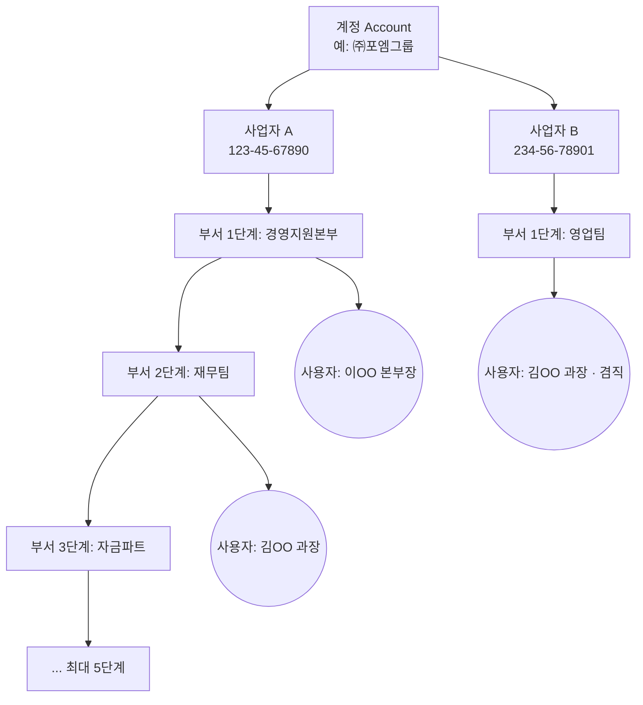
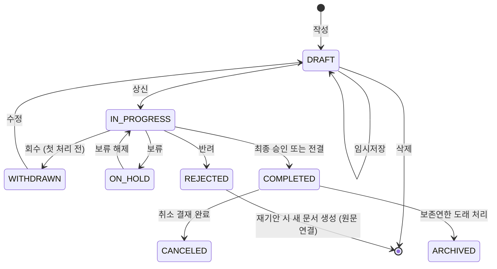
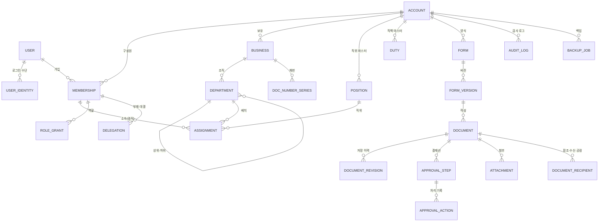

# 4mERP 제품 요구사항 정의서 (PRD)

| 항목 | 내용 |
|---|---|
| 문서 버전 | v0.2 |
| 작성일 | 2026-10-03 |
| 상태 | 검토 대기 |
| 변경 이력 | v0.2 — 목표 사용자 100명 이하. "로컬 저장(백업)"을 **S3 문서 원본 보관소 + 이관 + DB 일일 자동·수동 덤프**로 다시 정의. 감사 기능을 Must / Should / Optional로 분류하고, **Optional은 구현 범위에서 제외** |
| 관련 문서 | [배포 계획서](./DEPLOYMENT_PLAN.md) |

---

## 1. 개요

### 1.1 배경
국내 중소기업의 결재·품의는 종이, 메신저, 엑셀, 이메일로 흩어져 있는 경우가 많습니다. 그러면 다음 문제가 생깁니다.
- 누가, 언제, 어떤 근거로 승인했는지 추적이 어려워 내부·외부 감사에 대응하기 힘듭니다.
- 조직 개편이나 인사 이동 뒤에 과거 결재 당시의 조직·직위를 복원할 수 없습니다.
- 클라우드 서비스에만 데이터를 두는 데 대한 불안 때문에 자체 보관(로컬 백업)을 요구합니다.

### 1.2 제품 비전
> **"소셜 로그인 한 번으로 시작하고, 감사에 강하며, 데이터는 우리 손에 남는 전자결재 중심 ERP"**

전자결재를 핵심 엔진으로 먼저 만들고, 인사·근태·회계·구매 같은 ERP 모듈은 이 결재 엔진 위에 얹는 구조로 확장합니다.

### 1.3 범위
| 구분 | 내용 |
|---|---|
| **1차 범위 (MVP)** | 소셜 로그인(Google, Naver), 계정→사업자→부서(최대 5단계)→사용자 조직 구조, 직위 관리, 전자결재(기안·결재·합의·감사·참조·수신), 감사(감사 단계 + 감사 로그 + 감사인 열람), 문서 원본 보관(S3)·이관·DB 덤프, 알림(인앱·이메일), 관리자 콘솔 |
| **2차 범위** | 근태·휴가, 경비·법인카드, 인사 발령, 웹 푸시·PWA, 패스키, 카카오 로그인, 오프라인 뷰어 |
| **3차 범위** | 회계(전표·거래처), 구매·재고, 영업(견적·수주), 자산, 외부 연동(세금계산서, 메신저 알림 등) |
| **범위 외** | 급여 계산 엔진, 4대보험 신고 자동화, 온프레미스 설치형 패키지 (모두 추후 검토) |

### 1.4 용어 정의
| 용어 | 정의 |
|---|---|
| **계정 (Account / Tenant)** | 서비스 가입·과금의 단위입니다. 하나의 계정 아래에 여러 사업자를 둘 수 있습니다. 데이터 격리의 최상위 경계입니다. |
| **사업자 (Business)** | 사업자등록번호를 가진 법적 단위입니다(법인 또는 개인사업자). 문서번호, 직인, 회계 단위의 기준입니다. |
| **부서 (Department)** | 사업자 아래의 조직 단위입니다. 트리 구조이며 최대 5단계(기본 1단계)까지 둘 수 있습니다. |
| **사용자 (User)** | 소셜 로그인으로 인증한 개인입니다. 계정 구성원(Member)으로 가입한 뒤 부서에 배치됩니다. |
| **직위 (Position)** | 사원, 대리, 과장, 부장처럼 조직 내 서열을 나타내는 호칭입니다. 서열(rank)이 있으며 결재란 표시와 자동 결재선에 쓰입니다. |
| **직책 (Duty)** | 팀장, 본부장, 대표이사처럼 맡은 역할입니다. "부서장 결재" 같은 동적 결재선에 쓰입니다. |
| **직급 (Grade)** | 급여·호봉 체계상의 등급입니다(2차, 선택). |
| **겸직** | 한 사용자가 여러 부서(또는 여러 사업자)에 동시에 소속된 상태입니다. 주소속은 1개입니다. |
| **기안 / 상신** | 결재 문서를 작성하는 것이 기안이고, 결재선에 올리는 것이 상신입니다. |
| **결재선** | 문서가 거쳐 가는 결재자·합의자·감사자·참조자·수신처의 순서와 구성입니다. |
| **결재** | 결재선의 승인권자가 승인·반려·보류하는 행위입니다. |
| **합의 / 협조** | 관련 부서 담당자가 동의 여부를 표시하는 단계입니다. 순차 또는 병렬로 진행합니다. |
| **감사 (결재 단계)** | 감사 부서·감사인이 결재 과정에서 적정성을 검토하는 단계입니다. |
| **감사 (사후)** | 감사인이 완료된 문서와 시스템 이력을 열람·검토하고 지적하는 활동입니다. |
| **감사 로그** | 시스템 안의 모든 주요 행위를 위·변조할 수 없게 기록한 이력입니다. |
| **참조** | 결재 권한 없이 문서를 열람하는 대상입니다. |
| **수신 / 접수** | 완료된 문서를 받는 부서와, 그 부서가 문서를 받아들이는 절차입니다. |
| **공람** | 완료된 문서를 정해진 사람들에게 회람하고 열람 여부를 확인하는 것입니다. |
| **전결** | 위임전결 규정에 따라 중간 결재자가 최종 결재권을 행사하는 것입니다. 이후 단계는 생략 처리됩니다. |
| **대결** | 결재자가 부재일 때 위임받은 사람이 대신 결재하는 것입니다. |
| **후결** | 결재가 먼저 완료된 뒤, 지정된 상위자가 사후에 확인 결재하는 것입니다. |
| **회수** | 기안자가 상신한 문서를 다음 결재자가 처리하기 전에 되돌리는 것입니다. |
| **반려** | 결재자가 문서를 승인하지 않고 돌려보내는 것입니다. |
| **보존연한** | 문서를 의무적으로 보관해야 하는 기간입니다(1·3·5·10년, 영구). |

---

## 2. 목표 및 성공 지표

### 2.1 제품 목표
| ID | 목표 |
|---|---|
| G1 | 별도 비밀번호 없이 Google·Naver 계정으로 5분 안에 가입하고 조직 구성을 마칠 수 있게 합니다. |
| G2 | 종이 결재에서 쓰던 결재 관행(합의, 전결, 대결, 후결, 수신, 공람)을 빠짐없이 지원합니다. |
| G3 | 모든 결재 행위와 데이터 변경을 위·변조를 탐지할 수 있는 감사 로그로 남깁니다. |
| G4 | 시스템에서 만든 모든 문서를 S3 버킷에 자기완결형 패키지로 보관해, 언제든 로컬이나 다른 서비스로 그대로 옮길 수 있게 합니다. |
| G5 | ERP 모듈이 공통 결재 엔진을 재사용하는 확장 가능한 구조를 만듭니다. |

### 2.2 비목표 (MVP)
- 자체 아이디·비밀번호 회원가입은 제공하지 않습니다(소셜 로그인 전용).
- 네이티브 모바일 앱은 만들지 않습니다(반응형 웹 + PWA로 대응).
- 공인 전자서명(인증서 기반) 연동은 하지 않습니다. 대신 결재 PIN·패스키로 재인증합니다.

### 2.3 성공 지표 (KPI)
| 지표 | 목표치 (출시 3개월) |
|---|---|
| 신규 계정의 조직 구성 완료율 (가입 후 24시간 내 부서 1개 이상 + 구성원 2명 이상) | ≥ 60% |
| 결재 문서 평균 처리 시간 (상신 → 완료) | 종이 대비 50% 단축 (고객 인터뷰 기준) |
| 모바일에서 처리한 결재 비율 | ≥ 30% |
| 일일 DB 덤프 성공률 | 100% (실패 시 30분 안에 알림) |
| 감사 로그 누락·변조 | 0건 |
| 결재 화면 p95 응답 시간 | < 1초 |

---

## 3. 사용자와 역할

### 3.1 페르소나
| 페르소나 | 설명 | 핵심 니즈 |
|---|---|---|
| 대표 / 임원 | 최종 결재권자이며 이동이 잦습니다. | 모바일에서 빠르게 결재하고, 금액·근거를 한눈에 보고 싶어 합니다. |
| 팀장 (부서장) | 중간 결재자이자 기안자입니다. | 결재 대기함, 위임 설정, 부서 문서를 조회하려 합니다. |
| 일반 직원 | 기안자입니다. | 쉬운 양식, 임시저장, 진행 상황 확인이 필요합니다. |
| 경영지원 / 시스템 관리자 | 조직·양식·권한을 관리합니다. | 조직도 편집, 양식 빌더, 백업 관리가 필요합니다. |
| 감사인 (내부 감사, 외부 회계사) | 결재 단계의 감사자이자 사후 감사자입니다. | 전체 문서 열람, 이력 추적, 로그 조회·내보내기가 필요합니다. |

### 3.2 시스템 역할 (RBAC)
역할은 **범위(scope)** 와 함께 부여합니다. 범위는 계정 전체, 특정 사업자, 특정 부서(하위 포함) 중 하나입니다.

| 역할 | 범위 | 주요 권한 |
|---|---|---|
| **계정 소유자 (Owner)** | 계정 | 모든 권한, 소유권 이전, 계정 삭제, 과금 관리 |
| **계정 관리자** | 계정 | 사업자·조직·사용자·역할·양식·백업 관리 (과금·소유권 제외) |
| **사업자 관리자** | 사업자 | 해당 사업자의 부서·구성원·양식·문서번호 규칙 관리 |
| **결재 관리자** | 계정/사업자 | 양식, 결재선 템플릿, 위임전결 규정 관리. 결재 진행 문서의 결재선 강제 수정(사유 필수, 감사 로그 기록) |
| **감사인 (Auditor)** | 계정/사업자/부서 | 범위 안의 모든 문서(보안 문서 포함) 읽기 전용 열람, 감사 로그 조회·내보내기, 월간 접속 기록 점검 |
| **인사 관리자** | 계정/사업자 | 구성원 정보, 발령, 직위·직책 관리 (2차: 근태·휴가) |
| **일반 구성원** | 본인 | 기안, 결재, 본인 관련 문서 열람 |

> 권한 원칙: **최소 권한**, **직무 분리**(백업 다운로드 권한과 감사 로그 삭제 권한은 한 사람에게 함께 주지 않으며, 감사 로그 삭제 기능은 아예 두지 않습니다), **모든 권한 변경은 감사 로그에 기록**합니다.

### 3.3 주요 권한 매트릭스 (MVP)
| 기능 | 소유자 | 계정관리자 | 사업자관리자 | 결재관리자 | 감사인 | 구성원 |
|---|:-:|:-:|:-:|:-:|:-:|:-:|
| 사업자 생성·삭제 | ✅ | ✅ | – | – | – | – |
| 부서 편집 | ✅ | ✅ | ✅ (범위) | – | – | – |
| 구성원 초대·비활성화 | ✅ | ✅ | ✅ (범위) | – | – | – |
| 양식·결재선 템플릿 관리 | ✅ | ✅ | ✅ (범위) | ✅ | – | – |
| 기안·결재 | ✅ | ✅ | ✅ | ✅ | ✅ | ✅ |
| 범위 내 전체 문서 열람 | ✅ | – ¹ | – ¹ | – ¹ | ✅ | – |
| 감사 로그 조회 | ✅ | ✅ | – | – | ✅ | – |
| 계정 전체 내보내기 (ZIP) | ✅ | ✅ ² | – | – | – | – |
| DB 수동 덤프 · 덤프 이력 조회 | ✅ ³ | – | – | – | – | – |

¹ 관리자라고 해서 결재 문서 본문을 열람할 수 있는 것은 아닙니다. 열람 권한은 결재선 참여자, 감사인, 문서 열람 권한을 별도로 부여받은 사람에게만 있습니다.
² 소유자가 허용한 경우에만 가능합니다. 다운로드할 때마다 재인증하고 감사 로그를 남깁니다.
³ DB 덤프에는 시스템 전체 데이터가 들어갑니다. 따라서 단일 회사로 운영할 때는 소유자가, 여러 회사에 판매하는 SaaS로 운영할 때는 운영자(시스템 관리자)만 실행합니다.

---

## 4. 릴리스 계획

| 단계 | 기간(안) | 범위 | 완료 기준 |
|---|---|---|---|
| **Phase 0 – 기반** | 4주 | 인증(Google·Naver), 계정·사업자·부서·사용자·직위, RBAC, 감사 로그 기반 | 조직도 구성 후 구성원 초대·로그인 가능 |
| **Phase 1 – MVP** | 8주 | 전자결재 전체(양식, 결재선, 결재 처리, 위임, 문서함, PDF), 감사 기능(Must 항목), S3 문서 패키지·이관·DB 덤프, 인앱·이메일 알림, 관리자 콘솔 | 파일럿 고객 1곳 이상이 실제 업무 결재를 4주 동안 무장애로 운영 + 이관 리허설 성공 |
| **Phase 2 – 업무 확장** | 8주 | 근태·휴가(결재 연동), 경비·지출결의, 인사 발령, PWA·웹 푸시, 패스키, 카카오 로그인, 오프라인 뷰어, 감사 Should 항목, 조직 개편 예약 | 휴가 신청부터 연차 차감까지 자동화 |
| **Phase 3 – ERP 코어** | 12주+ | 회계 전표, 거래처, 구매·재고, 영업, 자산, 외부 연동 API | 구매 요청 → 발주 → 입고 → 전표 흐름이 결재와 연동되어 동작 |
| **Phase 4 – 고도화** | – | 리포트 빌더, 영문 UI, 전자세금계산서, OCR, 메신저 연동, 과금 | – |

---

## 5. 기능 요구사항

> 우선순위: **P0** = MVP 필수, **P1** = MVP 직후(Phase 2), **P2** = 이후 단계

### 5.1 인증 및 사용자 계정 (AUTH)

| ID | 요구사항 | 우선순위 |
|---|---|---|
| AUTH-001 | **Google 로그인**(OIDC)을 지원합니다. `sub` 클레임을 고유 식별자로 사용합니다. | P0 |
| AUTH-002 | **Naver 로그인**(OAuth 2.0 + 회원 프로필 API)을 지원합니다. 네이버 `id`(앱별 고유값)를 고유 식별자로 사용합니다. 이메일은 바뀌거나 제공되지 않을 수 있으므로 식별자로 쓰지 않습니다. | P0 |
| AUTH-003 | 한 사용자에게 여러 소셜 계정을 **연결(Link)** 하거나 해제할 수 있습니다. 마지막 남은 로그인 수단은 해제할 수 없습니다. | P0 |
| AUTH-004 | 이메일이 같다는 이유만으로 계정을 자동 병합하지 않습니다. 로그인 상태에서 사용자가 명시적으로 연결해야 합니다(계정 탈취 방지). | P0 |
| AUTH-005 | 최초 로그인 사용자는 ① 새 계정(회사) 생성, ② 초대 링크·코드로 기존 계정 합류, ③ 도메인 자동 합류(Google Workspace의 `hd` 클레임이 관리자가 허용한 도메인과 일치할 때, 관리자 승인 옵션 포함) 중 하나를 고릅니다. | P0 |
| AUTH-006 | **초대**: 관리자는 이메일 또는 링크로 초대하고, 초대할 때 사업자·부서·직위를 미리 지정할 수 있습니다. 초대 링크는 기본 7일 후 만료되며 1회만 쓸 수 있습니다. | P0 |
| AUTH-007 | 한 사용자가 **여러 계정(회사)에 소속**될 수 있으며, 로그인 후 계정을 전환할 수 있습니다. | P0 |
| AUTH-008 | 세션은 HttpOnly·Secure·SameSite 쿠키로 관리합니다. 유휴 타임아웃(기본 2시간)과 절대 만료(기본 12시간)는 계정별로 설정할 수 있습니다. 동시 세션을 조회하고 강제 로그아웃할 수 있습니다. | P0 |
| AUTH-009 | **결재 재인증(결재 PIN)**: 소셜 로그인에는 비밀번호가 없으므로, 결재·백업 다운로드 같은 민감 행위 전에 별도의 6자리 이상 PIN을 확인합니다. PIN은 Argon2id로 해시합니다. 5회 실패 시 15분 잠금합니다. 계정 설정으로 PIN 사용 여부를 정합니다. | P0 |
| AUTH-010 | **패스키(WebAuthn)** 를 재인증 수단으로 등록할 수 있습니다(PIN 대체). | P1 |
| AUTH-011 | 관리자 역할 보유자에게 재인증 정책(관리 콘솔 진입 시 재인증)을 강제할 수 있습니다. | P1 |
| AUTH-012 | 카카오 로그인을 지원합니다. | P1 |
| AUTH-013 | 로그인 이력(일시, IP, 기기, 성공·실패, 제공자)을 기록하고 본인과 관리자가 조회할 수 있습니다. | P0 |
| AUTH-014 | IP 허용 목록(사무실 IP만 접속)을 계정 단위로 설정할 수 있습니다. | P2 |
| AUTH-015 | 퇴사·비활성화된 구성원은 즉시 모든 세션이 종료되고 로그인이 차단됩니다. 이 구성원의 데이터와 결재 이력은 보존합니다. | P0 |
| AUTH-016 | 개인 프로필: 이름, 표시 이름, 휴대폰(선택), 프로필 사진, **서명 이미지 / 개인 도장 이미지** 등록. | P0 |

### 5.2 조직 구조 (ORG)

#### 5.2.1 계층 구조


#### 5.2.2 계정 / 사업자
| ID | 요구사항 | 우선순위 |
|---|---|---|
| ORG-001 | 계정은 이름, 로고, 기본 시간대(Asia/Seoul), 기본 언어, 허용 도메인, 보안 정책을 가집니다. | P0 |
| ORG-002 | 계정 아래에 **사업자를 1개 이상** 등록합니다. 계정을 처음 만들 때 첫 사업자 등록을 안내합니다. | P0 |
| ORG-003 | 사업자 정보: 상호, **사업자등록번호(10자리, 체크섬 검증)**, 법인등록번호(선택), 대표자, 업태·종목, 주소, 대표 전화, 사업자 코드(문서번호용), **직인 이미지**. | P0 |
| ORG-004 | 같은 계정 안에서 사업자등록번호는 중복될 수 없습니다. | P0 |
| ORG-005 | 사업자는 삭제하지 않고 **비활성화**합니다(문서·이력 보존). 진행 중인 결재가 있으면 비활성화할 수 없습니다. | P0 |
| ORG-006 | 국세청 사업자 상태 조회 API로 휴·폐업 여부를 확인합니다. | P2 |

#### 5.2.3 부서
| ID | 요구사항 | 우선순위 |
|---|---|---|
| ORG-010 | 부서는 사업자에 속하는 트리 구조입니다. **최대 뎁스는 계정 설정값(1~5, 기본 1)** 을 따릅니다. 뎁스 1은 사업자 바로 아래의 부서입니다. | P0 |
| ORG-011 | 부서를 만들 때 `부모 뎁스 + 1 ≤ 최대 뎁스`인지 검증하고, 넘으면 생성 버튼을 비활성화하고 안내합니다. | P0 |
| ORG-012 | 최대 뎁스를 **높이는 것**은 언제든 가능합니다. **낮추려면** 새 값을 넘는 부서가 하나도 없어야 하며, 있으면 해당 부서 목록을 보여 주고 변경을 거부합니다. | P0 |
| ORG-013 | 부서 **이동**(드래그 앤 드롭): 이동 후 하위 트리의 최대 뎁스가 한도를 넘으면 거부합니다. 다른 사업자로 옮기는 것은 허용하지 않습니다. | P0 |
| ORG-014 | 부서 속성: 부서명, 부서 코드(사업자 안에서 고유), 정렬 순서, 부서장(구성원 1명), 부서 약칭, 사용 여부, 유효 시작일·종료일. | P0 |
| ORG-015 | 하위 부서나 소속원이 있는 부서, 또는 진행 중인 결재의 결재선에 들어 있는 부서는 삭제할 수 없고 **폐지(비활성)** 처리만 할 수 있습니다. | P0 |
| ORG-016 | 조직도 화면: 트리 보기와 조직도 차트 보기, 부서 검색, 구성원 수 표시, 엑셀(CSV) 내보내기·가져오기(일괄 등록 시 뎁스 검증 포함). | P0 |
| ORG-017 | 결재 문서에는 **기안·결재 시점의 부서명·직위·직책을 스냅샷**으로 저장합니다. 이후 조직이 바뀌어도 과거 문서 표기는 변하지 않습니다. | P0 |
| ORG-018 | **조직 개편 예약**: 미래 일자에 효력이 생기는 개편안을 미리 작성하고, 그날 0시에 자동 적용합니다. | P1 |
| ORG-019 | 조직 변경 이력(언제 누가 어떤 부서를 생성·이동·폐지했는지)을 시점별로 조회할 수 있습니다(특정 일자 기준 조직도 보기). | P1 |
| ORG-020 | 최대 뎁스를 사업자 단위로 따로 설정할 수 있습니다(계정 값은 기본값으로 사용). | P2 |

#### 5.2.4 사용자 소속 / 직위
| ID | 요구사항 | 우선순위 |
|---|---|---|
| ORG-030 | **직위 마스터**는 계정 단위로 관리합니다: 명칭, 서열(숫자, 클수록 상위), 사용 여부. 기본값: 사원 < 주임 < 대리 < 과장 < 차장 < 부장 < 이사 < 상무 < 전무 < 부사장 < 사장 < 대표이사(수정 가능). | P0 |
| ORG-031 | **직책 마스터**: 팀장, 파트장, 본부장, 대표이사 등. 부서장 지정과 연동합니다. | P0 |
| ORG-032 | 사용자 **소속(Assignment)** = (사업자, 부서, 직위, 직책, 주소속 여부, 시작일, 종료일). 사용자마다 주소속은 1개만 있어야 합니다. | P0 |
| ORG-033 | **겸직**: 한 사용자가 여러 부서, 여러 사업자에 소속될 수 있습니다. 기안할 때 어느 소속으로 기안할지 고릅니다(기본은 주소속). | P0 |
| ORG-034 | 구성원 정보: 사번(계정 안에서 고유, 선택), 이름, 이메일, 휴대폰, 입사일, 상태(초대됨 / 재직 / 휴직 / 퇴사). | P0 |
| ORG-035 | 직위·부서 변경은 **발령 이력**으로 남습니다(발령일, 사유, 처리자). | P0 |
| ORG-036 | 퇴사 처리 때 진행 중인 결재 대기 문서가 있으면 경고하고, 대체 결재자를 지정해 일괄 이관합니다. | P0 |
| ORG-037 | 직급(Grade)·호봉 관리. | P2 |

### 5.3 권한 관리 (PERM)
| ID | 요구사항 | 우선순위 |
|---|---|---|
| PERM-001 | 3.2절의 역할을 **범위(계정 / 사업자 / 부서+하위)** 와 함께 부여합니다. | P0 |
| PERM-002 | 모든 데이터 접근은 서버에서 **테넌트(계정) 격리**를 강제합니다. 애플리케이션 계층 검사에 더해 DB 행 수준 보안(RLS)을 적용합니다. | P0 |
| PERM-003 | 문서 열람 권한 = 결재선 참여자 ∪ 참조자 ∪ 수신 부서원(접수 후) ∪ 공람 대상 ∪ 범위 안의 감사인 ∪ 별도 열람 권한 부여자. 보안 등급이 "대외비" 이상이면 수신 부서는 접수자만 열람합니다. | P0 |
| PERM-004 | 부서 문서함 열람 권한(부서장, 부서원 전체 등)을 양식별로 설정할 수 있습니다. | P1 |
| PERM-005 | 사용자 정의 역할(권한 체크박스 조합). | P2 |

### 5.4 전자결재 (APV)

#### 5.4.1 결재 문서 상태 흐름


결재선 단계(Step)의 상태: `PENDING`(대기) → `ACTIVE`(내 차례) → `APPROVED` / `REJECTED` / `HELD` / `SKIPPED`(전결 이후) / `DELEGATED`(대결 처리) / `POST_PENDING`(후결 대기) → `POST_APPROVED`

#### 5.4.2 양식 관리
| ID | 요구사항 | 우선순위 |
|---|---|---|
| APV-001 | **양식 빌더**: 텍스트, 여러 줄 텍스트, 숫자, 금액(원화, 천 단위 구분), 날짜, 기간, 단일·다중 선택, 사용자 선택, 부서 선택, 거래처 선택(3차), **표(행 추가 + 열 합계)**, 리치 텍스트 본문, 첨부 필드. 필수 여부, 기본값, 입력 검증(최소·최대, 정규식)을 지원합니다. | P0 |
| APV-002 | 계산 필드: 표 합계, 공급가액 → 부가세 → 합계 같은 간단한 수식. | P1 |
| APV-003 | **기본 양식 제공**: 일반 기안, 품의서, 지출결의서, 휴가신청서, 출장신청서·출장보고서, 업무협조전, 구매요청서. | P0 |
| APV-004 | 양식 속성: 분류(폴더), 사용 범위(사업자·부서), 기본 결재선 템플릿, 문서번호 규칙, **보존연한**(1·3·5·10년, 영구), 보안 등급 기본값, 참조·수신 기본값, 결재선 수정 허용 여부, 전결 규정 연결. | P0 |
| APV-005 | 양식은 **버전 관리**합니다. 수정하면 새 버전이 되고, 이미 작성된 문서는 작성 당시 버전으로 렌더링합니다. | P0 |
| APV-006 | 양식 미리보기, 복제, 사용 중지, 가져오기·내보내기(JSON). | P0 |
| APV-007 | 인쇄·PDF 레이아웃: 결재란 위치, 로고·직인 위치, 용지(A4 세로·가로). | P0 |

#### 5.4.3 기안 / 상신
| ID | 요구사항 | 우선순위 |
|---|---|---|
| APV-010 | 양식을 골라 기안합니다. 최근 사용 양식과 즐겨찾기를 제공합니다. | P0 |
| APV-011 | **임시저장**: 수동 저장과 30초 간격 자동 저장(서버)을 지원합니다. 네트워크가 끊길 때를 대비해 브라우저 로컬(IndexedDB)에도 사본을 두고, 다시 접속하면 복구 여부를 묻습니다. | P0 |
| APV-012 | 기안 소속 선택(겸직자), 제목, 본문, 보안 등급(일반 / 대외비 / 비밀), 긴급 표시, 희망 완료일. | P0 |
| APV-013 | 첨부파일: 드래그 앤 드롭, 파일당 기본 50MB·문서당 300MB(계정 설정), 허용 확장자 정책. 업로드 후 미리보기(PDF·이미지·오피스 문서는 P1). | P0 |
| APV-014 | **관련 문서 연결**: 기존 결재 문서를 참조로 링크합니다(권한이 있는 문서만). | P0 |
| APV-015 | 상신 전 검증: 필수 필드, 결재선 유효성(비활성 사용자, 순환, 본인만 있는 결재선 등), 첨부 용량. | P0 |
| APV-016 | 상신 시 문서 내용·첨부의 **해시(SHA-256)** 를 기록합니다. 이후 결재자가 보는 내용이 상신 원본과 같은지 보장합니다. | P0 |
| APV-017 | 결재 진행 중 기안자가 할 수 있는 일: 회수(첫 결재자가 처리하기 전), 의견 추가, 진행 현황 조회. 내용 수정은 회수한 뒤에만 가능합니다. | P0 |
| APV-018 | 결재자에 의한 **본문 수정 허용** 옵션(양식별): 결재자가 수정하면 수정 전·후 버전을 모두 보존하고 변경 내역을 비교해 보여 줍니다. | P1 |
| APV-019 | 반려 문서 **재기안**: 원문을 복사해 새 초안을 만들고, 원문과 연결합니다. | P0 |
| APV-020 | 일괄 기안(엑셀 업로드로 여러 문서 생성). | P2 |

#### 5.4.4 결재선
| ID | 요구사항 | 우선순위 |
|---|---|---|
| APV-030 | 단계 유형: **결재**, **합의**(순차·병렬), **협조**, **감사**, **참조**, **수신**, **공람**, **후결**. | P0 |
| APV-031 | 단계 대상: ① 특정 사용자, ② 특정 부서(부서원 중 1명이 처리하거나 부서장이 처리), ③ **동적 대상**: "기안자의 부서장", "기안자 상위 N단계 부서장", "직책 = 본부장", "특정 사업자의 대표이사". | P0 |
| APV-032 | **병렬 그룹**: 같은 순번의 여러 합의자가 동시에 처리합니다. 완료 조건은 전원 동의 또는 N명 동의 중에서 고릅니다. | P0 |
| APV-033 | **결재선 템플릿**: 양식별 기본 결재선과 개인 즐겨찾기 결재선. | P0 |
| APV-034 | **조건부 결재선**: 양식 필드 값에 따른 규칙. 예: 금액 ≥ 1,000만 원이면 대표이사 단계 추가, 휴가 3일 이상이면 본부장 추가. | P1 |
| APV-035 | **위임전결 규정표**: (양식 분류 × 금액 구간 × 직책) → 전결권자. 상신할 때 전결권자를 자동으로 표시하고, 전결권자가 승인하면 이후 결재 단계는 `SKIPPED` 처리합니다. 후결 대상이 지정되어 있으면 후결 단계를 만듭니다. | P1 |
| APV-036 | 결재선 화면: 조직도 트리에서 사용자·부서를 고르고, 순서를 드래그로 바꾸고, 단계 유형을 전환합니다. 결재란 미리보기를 제공합니다. | P0 |
| APV-037 | 결재 진행 중 결재선 변경: 아직 처리하지 않은 이후 단계에 한해, 양식이 허용할 때 현재 결재자 또는 결재 관리자가 추가·삭제할 수 있습니다. 사유는 필수이며 감사 로그에 남습니다. | P0 |
| APV-038 | 결재선 검증: 같은 사람이 여러 단계에 있으면 경고(허용 여부는 설정), 비활성·퇴사자 포함 시 상신 차단, 서열 역순(하위 직위가 상위보다 뒤) 경고. | P0 |

#### 5.4.5 결재 처리
| ID | 요구사항 | 우선순위 |
|---|---|---|
| APV-040 | 처리 행위: **승인**, **반려**, **보류**, **전결**(권한 있을 때), 합의 단계에서는 **동의 / 부동의**(부동의 시 반려로 갈지 의견만 남기고 진행할지는 양식 설정), 감사 단계에서는 **감사 승인 / 감사 반려 / 의견 첨부**. | P0 |
| APV-041 | 반려 대상: 기안자에게 반려(기본) 또는 직전 단계로 반려(양식 옵션). 반려 사유는 필수입니다. | P0 |
| APV-042 | 의견(코멘트): 단계별 의견, 첨부 가능, 공개 범위(결재선 전체 / 기안자만). | P0 |
| APV-043 | 결재할 때 **재인증**(AUTH-009). "30분 동안 재인증 생략" 옵션을 제공합니다(계정 정책으로 끌 수 있음). | P0 |
| APV-044 | **일괄 결재**: 결재 대기함에서 여러 문서를 골라 한 번에 승인합니다(양식별로 허용 여부 설정, 반려는 개별 처리만 가능). | P1 |
| APV-045 | 동시성 제어: 같은 단계를 두 번 처리하지 못하게 낙관적 잠금과 멱등 키를 사용합니다. 대결자와 원 결재자가 동시에 처리하면 먼저 처리한 쪽만 반영합니다. | P0 |
| APV-046 | 결재 처리 결과(행위자, 대리 여부, 일시, IP, 기기, 의견, 문서 해시)를 `approval_action`에 append-only로 저장합니다. | P0 |
| APV-047 | 결재 기한(SLA): 양식별 기한(예: 단계당 2영업일)을 넘기면 독촉 알림을 보내고 관리자 리포트에 표시합니다. | P1 |
| APV-048 | 모바일 결재: 반응형 화면에서 문서 본문, 첨부 미리보기, 승인·반려, 의견 작성을 모두 할 수 있어야 합니다. | P0 |

#### 5.4.6 위임 / 부재 (대결)
| ID | 요구사항 | 우선순위 |
|---|---|---|
| APV-050 | 부재 설정: 기간, 사유(휴가·출장·기타), 대결자, 적용 범위(전체 / 특정 양식 분류). | P0 |
| APV-051 | 부재 기간 중 결재 차례가 오면 대결자에게 알립니다. 대결자가 처리하면 결재란에 "대결 OOO"로 표시하고, 원 결재자는 **후열**(사후 열람 확인)할 수 있습니다. | P0 |
| APV-052 | 관리자는 다른 사람의 부재·대결을 설정할 수 있습니다(갑작스러운 부재 대응). 감사 로그에 기록합니다. | P0 |
| APV-053 | 대결자가 다시 위임할 수는 없습니다(연쇄 위임 금지). 대결자도 부재이면 관리자에게 알립니다. | P0 |

#### 5.4.7 완료 처리 / 문서번호
| ID | 요구사항 | 우선순위 |
|---|---|---|
| APV-060 | **문서번호 규칙**: 토큰 조합 `{사업자코드}`, `{부서코드}`, `{양식코드}`, `{YYYY}`, `{YY}`, `{MM}`, `{SEQ:n}`. 예: `4M-FIN-2026-0012`. 일련번호 초기화 주기(연·월·안 함)를 정할 수 있습니다. | P0 |
| APV-061 | 채번 시점: 상신 시 또는 완료 시(양식 설정). 같은 시리즈 안에서 **누락·중복 없는 순번**을 보장합니다(DB 트랜잭션 + 시리즈 행 잠금). | P0 |
| APV-062 | 완료된 문서는 **불변(immutable)** 입니다. 본문·첨부·결재선을 수정할 수 없으며, 취소는 "취소 기안"(원문을 참조하는 별도 결재)으로만 할 수 있습니다. | P0 |
| APV-063 | 완료 시 **PDF를 생성**합니다(결재란에 직위·성명·서명 또는 도장·일시, 문서번호 표시). PDF는 S3 완료 패키지(BAK-003)에 결재 이력·해시와 함께 저장합니다. | P0 |
| APV-064 | 완료 이벤트를 발행합니다(연동된 ERP 모듈과 웹훅에 콜백). | P0 |

#### 5.4.8 수신 / 공람
| ID | 요구사항 | 우선순위 |
|---|---|---|
| APV-070 | 수신 부서 지정 → 완료 시 수신 부서 문서함으로 전달 → 수신 담당자(부서장 또는 지정 담당자)가 **접수**하고, 필요하면 부서 안 담당자에게 **배부**합니다. | P0 |
| APV-071 | 수신 부서는 **반송**(사유 필수)할 수 있습니다. | P1 |
| APV-072 | **공람**: 완료된 문서를 지정한 사람·부서에 회람하고, 사람별 열람 일시를 추적합니다. | P0 |
| APV-073 | 참조자는 상신 즉시(또는 완료 시, 양식 설정) 열람할 수 있으며, 열람 여부를 표시합니다. | P0 |

#### 5.4.9 문서함 / 검색
| ID | 요구사항 | 우선순위 |
|---|---|---|
| APV-080 | 개인 문서함: **결재 대기**, **결재 예정**(앞으로 내 차례), **진행 중**(내가 관여), **기안함**(상신 / 임시저장 / 회수 / 반려), **완료함**, **참조함**, **수신함**, **공람함**, **후결·후열함**. | P0 |
| APV-081 | 부서 문서함(부서에서 기안·수신한 완료 문서), 감사함(감사인용, 범위 내 전체). | P0 |
| APV-082 | 검색: 제목, 본문 전문, 문서번호, 기안자, 기안 부서, 양식, 기간, 상태, 금액 범위, 첨부 파일명. 결과는 열람 권한으로 필터링합니다. | P0 |
| APV-083 | 목록 내보내기(CSV·엑셀). 내보내기 행위는 감사 로그에 기록합니다. | P0 |
| APV-084 | 저장된 검색 조건, 문서 라벨(개인 태그). | P2 |

#### 5.4.10 ERP 모듈 연동 결재
| ID | 요구사항 | 우선순위 |
|---|---|---|
| APV-090 | 결재 엔진은 **모듈과 무관한 공통 서비스**입니다. 모듈(휴가, 경비, 구매 등)은 `결재 요청(sourceType, sourceId, 양식, 데이터)`을 생성하고, `승인 완료 / 반려 / 취소` 이벤트를 구독해 자기 상태를 바꿉니다. | P0 (구조) |
| APV-091 | 연동 문서는 원본 업무 데이터 스냅샷을 문서에 포함하고, 원본 화면으로 가는 링크를 제공합니다. | P1 |

### 5.5 감사 (AUD)

> **구분 기준**
> - **Must**: 법적 의무이거나, 요청하신 핵심 흐름(기안 → 결재 → 감사)에 꼭 필요한 기능입니다. MVP(P0)에 반드시 포함합니다.
> - **Should**: 법적 의무는 아니지만 구현 비용이 낮고 분쟁·감사 대응 효과가 큰 기능입니다. MVP 또는 그 직후(P0~P1)에 포함하기를 권장합니다.
> - **Optional**: 구현 범위에서 **제외**합니다(10.3절 참조).
>
> 법적 근거는 주로 **개인정보의 안전성 확보조치 기준**(접속 기록 보관·점검, 권한 변경 기록)과 **전자문서법 제5조**(작성자·일시 보존)입니다. 직원 개인정보를 다루는 시스템이므로 회사 규모와 관계없이 적용됩니다.

#### 5.5.1 결재선 감사 단계
| ID | 요구사항 | 구분 | 우선순위 |
|---|---|---|---|
| AUD-001 | 결재선에 **감사 단계**를 넣을 수 있습니다. 대상은 감사 부서 또는 감사인 역할 사용자입니다. | Must | P0 |
| AUD-002 | 감사 단계의 권한(승인·반려 가능, 또는 의견만 가능)을 양식별로 설정합니다. | Must | P0 |

#### 5.5.2 감사인 열람 · 사후 감사
| ID | 요구사항 | 구분 | 우선순위 |
|---|---|---|---|
| AUD-010 | 감사인은 부여받은 범위 안의 **모든 결재 문서**(보안 등급 포함, 임시저장 제외)를 읽기 전용으로 열람합니다. 감사인의 열람 자체도 감사 로그에 남습니다. | Must | P0 |
| AUD-011 | 문서별 **이력 타임라인**: 작성 → 상신 → 각 단계 처리(대결 여부 포함) → 결재선 변경 → 다운로드·인쇄 → 완료 → 공람. | Must | P0 |
| AUD-012 | **무결성 검증** 버튼: S3 패키지의 `manifest.json` 해시와 실제 파일(PDF·본문·첨부)을 대조한 결과를 표시합니다. | Should | P1 |

#### 5.5.3 감사 로그 (Audit Trail)
| ID | 요구사항 | 구분 | 우선순위 |
|---|---|---|---|
| AUD-020 | **필수 기록 대상**: 로그인·로그아웃·로그인 실패, **권한 부여·변경·말소**, **구성원 개인정보 조회·수정·다운로드**, 결재 행위 전체(상신·승인·반려·보류·회수·전결·대결·결재선 변경), 문서·첨부 다운로드와 인쇄, 계정 내보내기·DB 덤프, 조직·보안 설정 변경. | Must | P0 |
| AUD-021 | **필수 기록 항목**: 행위자 계정, 일시(UTC 저장, KST 표시), 접속지(IP), 처리한 대상(정보주체·문서 식별자), 수행 업무(행위 유형), 결과(성공·실패). 대리 처리일 때는 원 권한자도 기록합니다. | Must | P0 |
| AUD-022 | **추가 전용(append-only)**: 애플리케이션에 수정·삭제 경로가 없고, DB 권한으로도 앱 계정의 UPDATE·DELETE를 막습니다(위·변조 방지 조치). | Must | P0 |
| AUD-023 | **분실 방지**: 감사 로그는 일일 DB 자동 덤프(BAK-005)에 포함되어 서버 밖 S3에 보관됩니다. | Must | P0 |
| AUD-024 | **보존 기간**: 접속 기록은 **1년 이상**(정보주체 5만 명 이상이거나 고유식별정보·민감정보를 처리하면 2년), 권한 부여·변경·말소 기록은 **3년 이상** 보관합니다. 결재 이력은 문서 패키지의 `approval.json`으로 문서 보존연한 동안 따로 보존됩니다. | Must | P0 |
| AUD-025 | **감사 로그 조회 화면**: 기간, 사용자, 행위 유형, 대상으로 필터링합니다. | Must | P0 |
| AUD-026 | **월 1회 접속 기록 점검 기록**: 관리자가 조회 화면에서 점검한 뒤 "점검 완료"(점검자, 일시, 메모, 이상 여부)를 남깁니다. 점검을 거르면 다음 달 초에 알림을 보냅니다. | Must | P0 |
| AUD-027 | 변경 전·후 값(diff) 기록: 조직·권한·양식·설정 변경 시 무엇이 어떻게 바뀌었는지 남깁니다. | Should | P0 |
| AUD-028 | 일반 문서 열람 기록: 보안 문서와 감사인 열람 외에, 모든 문서 열람을 기록합니다. | Should | P1 |
| AUD-029 | 감사 로그 CSV 내보내기 (내보내기 행위도 기록). | Should | P1 |
| AUD-030 | 이상 패턴 자동 요약: 심야 대량 다운로드, 반복 로그인 실패, 권한 상승을 월간 점검 화면에 미리 표시합니다. | Should | P1 |

### 5.6 문서 원본 보관 · 이관 · 백업 (BAK)

> "로컬 저장(백업)"의 목적은 **시스템에서 만든 모든 문서를 로컬·다른 서버·다른 서비스로 옮길 수 있게 하는 것**입니다. 그래서 다음과 같이 설계합니다.
> - 문서는 처음부터 **S3 버킷**에 저장합니다.
> - 결재가 완료되면 **DB 없이도 의미가 통하는 자기완결형 패키지**로 고정합니다.
> - DB(조직, 진행 상태, 감사 로그)는 **일일 자동 덤프 + 관리자 수동 덤프**로 보호합니다.
>
> 디스크 스냅샷이나 연속 백업은 쓰지 않습니다. 버킷 구조와 복구 절차는 [배포 계획서](./DEPLOYMENT_PLAN.md) 2장과 7장을 참조하세요.

| ID | 요구사항 | 우선순위 |
|---|---|---|
| BAK-001 | **클라이언트 로컬 저장**: 기안·의견 작성 중인 내용을 브라우저 IndexedDB에 자동 저장합니다(사용자·계정별로 분리, 로그아웃 시 삭제). | P0 |
| BAK-002 | **문서 저장소 = S3 호환 버킷(서버 외부)**: 작성 중인 본문은 저장할 때마다 새 리비전 키로 기록하고(덮어쓰지 않음), 첨부도 버킷에 저장합니다. DB에는 검색·목록·권한 처리를 위한 정보와 S3 키만 둡니다. | P0 |
| BAK-003 | **완료 패키지**: 결재가 완료되면 `final/` 경로에 `document.pdf`(결재란 포함), `document.json`(양식 데이터), `approval.json`(결재선, 처리자·대결 여부·일시·IP·의견, 파일별 SHA-256), `manifest.json`을 **한 번만** 씁니다. 이 패키지가 전자문서법 제5조의 보관 요건(열람 가능, 원형 보존, 작성자·일시 보존)을 충족하는 원본입니다. | P0 |
| BAK-004 | **버킷 보호**: 애플리케이션 키에는 삭제 권한을 주지 않습니다. `final/` 경로는 공급자의 버전 관리 또는 보존 잠금 기능으로 보존연한 동안 지울 수 없게 합니다. | P0 |
| BAK-005 | **DB 자동 일일 덤프**: 매일 03:00 KST에 `pg_dump`를 실행하고, 암호화해 버킷에 저장합니다. 직전 덤프 이후 변경이 없으면 건너뜁니다. 보관은 일 7개 + 주 4개입니다. 덤프의 해시와 크기를 기록하고, 실패하면 30분 안에 관리자에게 알립니다. | P0 |
| BAK-006 | **DB 수동 덤프**: 관리 콘솔 버튼으로 즉시 실행합니다(재인증 필요). 관리자가 삭제할 때까지 보관합니다. 운영 배포 직전에도 자동으로 실행합니다. | P0 |
| BAK-007 | **덤프·내보내기 이력 화면**: 일시, 유형(자동·수동·내보내기), 크기, 해시, 상태, 실행자, 다운로드 이력. | P0 |
| BAK-008 | **문서 단위 다운로드**: 완료 문서를 PDF 또는 패키지 ZIP으로 받습니다. 권한자만 가능하며 기록합니다. | P0 |
| BAK-009 | **계정 전체 내보내기**: 관리자가 요청하면, 해당 계정의 문서 패키지 전체 + 조직·양식·감사 로그(JSON·CSV) + `manifest.json`을 ZIP으로 만듭니다. 비밀번호 암호화는 선택입니다. 다운로드는 7일 동안 유효한 서명 URL로 제공하고, 재인증과 기록을 거칩니다. | P0 |
| BAK-010 | **이관 도구**: ① 버킷 전체 복사(rclone) + DB 복원 스크립트, ② **S3 패키지로 DB 색인을 다시 만드는 스크립트**(DB를 잃었을 때 마지막 덤프 이후 완료된 문서를 복원하는 데도 사용), ③ 이관 절차 문서. | P0 |
| BAK-011 | **오프라인 뷰어**: 내보내기 ZIP 안에 `index.html`을 넣어, 서버 없이 브라우저만으로 문서를 검색하고 열람할 수 있게 합니다. | P1 |
| BAK-012 | **로컬 2차 사본 가이드**: 사내 PC·NAS에서 버킷을 주기적으로 단방향 복사(rclone copy)하는 설정 방법과 전용 읽기 키를 발급합니다. | P1 |
| BAK-013 | 서비스 해지 시 최종 내보내기를 자동 생성해 30일 동안 다운로드할 수 있게 한 뒤, 데이터를 파기하고 파기 확인서를 발급합니다. | P1 |
| BAK-014 | 다른 시스템에서 가져온 패키지를 "읽기 전용 보관 문서"로 등록합니다. | P2 |

### 5.7 알림 (NTF)
| ID | 요구사항 | 우선순위 |
|---|---|---|
| NTF-001 | 알림 이벤트: 결재 요청(내 차례), 승인·반려·보류, 최종 완료, 회수, 의견 등록, 참조·수신·공람 도착, 대결 지정, 기한 임박·초과, 백업 완료·실패, 초대, 보안 이벤트(새 기기 로그인). | P0 |
| NTF-002 | 채널: **인앱**(실시간 배지, 알림 센터), **이메일**. | P0 |
| NTF-003 | **웹 푸시**(PWA). | P1 |
| NTF-004 | 카카오 알림톡, Slack·Teams·잔디 웹훅. | P2 |
| NTF-005 | 사용자별 채널·이벤트 설정, 방해 금지 시간, 하루 1회 요약 메일 옵션. | P1 |
| NTF-006 | 이메일 알림에서 바로 결재하는 링크는 로그인과 재인증을 거쳐야 합니다(링크만으로 승인되지 않음). | P0 |

### 5.8 홈 / 대시보드 (DSH)
| ID | 요구사항 | 우선순위 |
|---|---|---|
| DSH-001 | 홈: 결재 대기 수, 진행 중 문서, 최근 완료 문서, 공지(계정 공지), 바로가기(자주 쓰는 양식). | P0 |
| DSH-002 | 관리자 대시보드: 구성원 수, 월별 결재 건수, 평균 처리 시간, 저장 용량 사용량, 최근 백업 상태. | P1 |
| DSH-003 | 공지사항·게시판(전사·부서). | P2 |

### 5.9 관리자 콘솔 (ADM)
| ID | 요구사항 | 우선순위 |
|---|---|---|
| ADM-001 | 계정 설정: 기본 정보, 허용 도메인, 부서 최대 뎁스, 세션 정책, 재인증 정책, 첨부 정책(크기·확장자). | P0 |
| ADM-002 | 사업자·부서·구성원·직위·직책 관리(5.2절). | P0 |
| ADM-003 | 역할·권한 부여(5.3절). | P0 |
| ADM-004 | 양식·결재선 템플릿·문서번호 규칙·보존연한 관리(5.4절). | P0 |
| ADM-005 | 결재 문서 관리: 진행 중 문서 결재선 강제 변경, 결재자 일괄 이관(퇴사·휴직), 장기 미처리 문서 목록. 모든 조치는 사유와 함께 기록합니다. | P0 |
| ADM-006 | DB 덤프·계정 내보내기(5.6절), 감사 로그·월간 점검(5.5절). | P0 |
| ADM-007 | 저장 용량 현황(문서·첨부·백업), 보존연한 도래 문서 처리(연장 또는 파기 승인 → 파기 기록). | P1 |
| ADM-008 | API 토큰·웹훅 관리. | P1 |

### 5.10 파일 / 첨부 (FILE)
| ID | 요구사항 | 우선순위 |
|---|---|---|
| FILE-001 | 파일은 S3 호환 스토리지 어댑터를 거쳐 **서버 외부 버킷**(R2, AWS S3 서울, NCP 등)에 저장합니다. 공급자를 바꿔도 코드는 바뀌지 않습니다. 로컬 개발·테스트 환경에서는 SeaweedFS로 대체합니다. | P0 |
| FILE-002 | 업로드 시 SHA-256 해시, MIME 검증(확장자 위장 차단), 크기 제한을 적용합니다. | P0 |
| FILE-003 | 악성코드 검사(ClamAV 등)는 비동기로 실행하고, 검사 전에는 다운로드를 보류합니다. | P1 |
| FILE-004 | 다운로드는 짧은 수명의 서명 URL로만 제공하고, 권한을 확인한 뒤 발급합니다. | P0 |
| FILE-005 | 미리보기: 이미지·PDF(P0), 오피스 문서(HWP, DOCX, XLSX → PDF 변환, P1). | P0 / P1 |
| FILE-006 | 다운로드·인쇄 워터마크(열람자 이름, 일시). | P2 |

### 5.11 ERP 확장 모듈 (Phase 2 이후)

모든 모듈은 공통 결재 엔진(APV-090), 공통 조직·권한, 공통 감사 로그를 재사용합니다.

| 모듈 | 핵심 요구사항 | 결재 연동 | 단계 |
|---|---|---|---|
| **근태 (ATT)** | 출퇴근 기록(웹·모바일, 위치·IP 조건), 근무제(고정·시차·선택), 주 52시간 모니터링, 근태 이상 알림 | 근태 수정 요청 | Phase 2 |
| **휴가 (LV)** | 휴가 종류 관리, **연차 자동 발생**(근로기준법 기준 · 회계연도/입사일 기준 선택), 반차·반반차, 잔여 연차, 연차 사용 촉진 알림 | 휴가 신청 → 승인 시 차감 | Phase 2 |
| **인사 (HR)** | 인사카드(학력·경력·자격·가족 등, 주민등록번호는 법적 근거가 있을 때만 암호화해 수집), 발령(이동·승진·휴직·퇴직), 증명서 발급(재직·경력) | 발령 품의, 증명서 신청 | Phase 2 |
| **경비 (EXP)** | 지출결의, 법인카드 사용 내역 가져오기, 영수증 첨부, 계정과목 매핑, 출장비 정산 | 지출결의 → 승인 시 전표 생성 | Phase 2 |
| **회계 (ACC)** | 계정과목, 거래처, 전표(일반·매입·매출), 분개, 시산표, 원장, 부가세 신고 자료, 마감 | 전표 승인 | Phase 3 |
| **구매 (PUR)** | 구매요청 → 견적 비교 → 발주 → 입고 → 매입 전표 | 구매요청·발주 품의 | Phase 3 |
| **재고 (INV)** | 품목, 창고, 입·출고, 재고 실사, 이동평균·선입선출 원가 | 재고 조정 품의 | Phase 3 |
| **영업 (SAL)** | 고객, 견적 → 수주 → 출고 → 매출 → 수금, 매출 채권 | 견적·할인 품의 | Phase 3 |
| **자산 (AST)** | 자산 대장, 취득·처분, 감가상각, 비품 대여 | 취득·처분 품의 | Phase 3 |
| **외부 연동** | 전자세금계산서(ASP 연동), 은행·카드 스크래핑(제휴사), 홈택스 자료 | – | Phase 4 |

### 5.12 API / 연동 (API)
| ID | 요구사항 | 우선순위 |
|---|---|---|
| API-001 | 내부 API는 REST(JSON)로 만들고 OpenAPI 명세를 자동 생성합니다. | P0 |
| API-002 | 계정 단위 **API 토큰**(범위 지정, 만료일, 마지막 사용 일시)을 발급합니다. 로컬 2차 사본·외부 연동에 사용합니다. | P1 |
| API-003 | **웹훅**: 결재 완료·반려, 구성원 변경 이벤트. HMAC 서명과 재시도(지수 백오프)를 적용합니다. | P1 |
| API-004 | 조직도 동기화 API(외부 HR 시스템 연동). | P2 |
| API-005 | 속도 제한: 토큰당 기본 60 req/min. | P1 |

### 5.13 과금 / 구독 (BIL) – SaaS로 판매할 경우
| ID | 요구사항 | 우선순위 |
|---|---|---|
| BIL-001 | 요금제: 구성원 수 기준 과금, 저장 용량 한도, 모듈 애드온. | P2 |
| BIL-002 | 결제 수단(카드 정기결제 PG 연동), 세금계산서 발행, 체험 기간(30일). | P2 |
| BIL-003 | 한도 초과 시 경고 → 유예 → 읽기 전용 전환(데이터 삭제 없음, 백업 다운로드는 항상 가능). | P2 |

---

## 6. 비기능 요구사항 (NFR)

### 6.1 성능
| ID | 요구사항 |
|---|---|
| NFR-P01 | API p95 응답 300ms 이하(목록·상세), 결재 처리 p95 500ms 이하 |
| NFR-P02 | 첫 화면 LCP 2.5초 이하(4G 모바일 기준) |
| NFR-P03 | 문서함 목록은 10만 건 이상에서도 1초 이내(인덱스·페이지네이션) |
| NFR-P04 | PDF 생성·백업 생성 같은 무거운 작업은 비동기 작업 큐에서 처리하고, API 응답을 막지 않습니다. |
| NFR-P05 | 설계 기준 부하: 총 사용자 100명, 피크 동시 접속 30명에서 위 기준을 만족. 500명까지는 서버 사양 상향만으로 대응할 수 있게 설계 (배포 계획서 5장 참조) |

### 6.2 가용성 · 복구
| ID | 요구사항 |
|---|---|
| NFR-A01 | 월 가용성 99%(MVP, 로컬 서버 1대 기준이며 정전·회선 장애 포함), 99.9%(이중화 또는 클라우드 이전 이후) |
| NFR-A02 | **RPO**: 완료 문서 0(완료 즉시 S3에 저장), DB 데이터(진행 중 결재, 조직, 감사 로그) 24시간 이하(일일 덤프). **RTO** 컨테이너 장애 30분 이하, 서버 하드웨어 고장 4시간 이하(예비 장비 사용) |
| NFR-A03 | 문서와 DB 덤프는 서버 밖의 S3 버킷에 둡니다. 로컬 2차 사본(BAK-012)은 선택입니다. |
| NFR-A04 | 분기 1회 이상 복구·이관 리허설을 하고 결과를 기록합니다. |

### 6.3 보안
| ID | 요구사항 |
|---|---|
| NFR-S01 | OWASP ASVS Level 2 준수를 목표로 합니다. |
| NFR-S02 | 전 구간 TLS 1.2 이상, HSTS 적용 |
| NFR-S03 | 저장 데이터 암호화: 디스크·스토리지 암호화, 민감 필드(휴대폰, 주민등록번호 등)는 애플리케이션 계층에서 암호화(키는 별도 관리, 교체 가능) |
| NFR-S04 | 테넌트 격리: 모든 테이블에 `account_id`, PostgreSQL RLS, 테넌트 간 접근 자동 테스트 |
| NFR-S05 | CSRF 방어, CSP, XSS 방지(리치 텍스트 서버측 정화), SQL 인젝션 방지(파라미터 바인딩), 파일 업로드 검증 |
| NFR-S06 | 속도 제한(로그인, PIN, API), 무차별 대입 탐지 |
| NFR-S07 | 비밀 값(OAuth 시크릿, DB 비밀번호, 암호화 키)은 저장소에 두지 않고 환경 변수·시크릿 관리 도구로 주입합니다. |
| NFR-S08 | 의존성 취약점 스캔(CI), 연 1회 외부 모의해킹(유료 고객 확보 후) |
| NFR-S09 | 운영자(우리 회사)도 고객 문서 본문을 열람할 수 없게 합니다. 장애 대응으로 접근이 필요하면 고객이 승인하고 그 기록을 남깁니다. |

### 6.4 법규 · 컴플라이언스 (대한민국)
> 아래는 설계에서 고려할 항목입니다. 출시 전에 법률 검토를 받아야 합니다.

| 법령·기준 | 시스템 반영 사항 |
|---|---|
| **개인정보 보호법** 및 **개인정보의 안전성 확보조치 기준** | 접근 권한 관리와 변경 기록 보관(3년), 접속 기록 보관(1년 이상, 대규모·민감정보 처리 시 2년)과 월 1회 이상 점검, 비밀번호·인증정보 암호화, 개인정보 처리방침 공개, 수집 최소화, 국외 이전 시 고지·동의 |
| 주민등록번호 처리 제한 | 법령에 근거가 있을 때만 수집하고 암호화해 저장합니다. MVP에서는 수집하지 않습니다. |
| **전자문서 및 전자거래 기본법** | 전자문서의 보관 요건을 충족합니다: 내용 열람 가능, 작성 당시 형태 유지(PDF·해시), 작성자·송수신 일시 식별 정보 보존. |
| **전자서명법** | 결재 PIN·패스키 재인증과 행위 기록으로 서명자를 확인하고 부인을 방지합니다. 공인 인증서는 범위 외입니다. |
| **상법 · 국세기본법 · 법인세법** | 회계 장부·증빙 보존 기간(상업장부 10년, 전표 등 5년, 국세 관련 5년)에 맞춘 보존연한 기본값 |
| **근로기준법** | 근로자 명부, 근로계약 관련 서류 3년 보존(인사·근태 모듈) |
| 정보통신망법 | 이용자 정보 보호, 침해 사고 신고 절차 |

### 6.5 사용성 · 접근성 · 호환성
| ID | 요구사항 |
|---|---|
| NFR-U01 | 지원 브라우저: Chrome, Edge, Safari, Whale, Firefox 최신 2개 버전. IE는 지원하지 않습니다. |
| NFR-U02 | 반응형: 360px 이상 모바일부터 지원합니다. 결재 처리는 모바일에서 모든 기능을 쓸 수 있어야 합니다. |
| NFR-U03 | 웹 접근성: KWCAG 2.2(WCAG 2.1 AA 수준). 키보드 조작과 스크린리더 레이블을 지원합니다. |
| NFR-U04 | 다크 모드(P1), 한국어 기본, 영어(P2) |
| NFR-U05 | 날짜는 KST로 표시하고 UTC로 저장합니다. 금액은 원화 정수(소수점 없음)로 처리하고, 외화는 2차에서 지원합니다. |

### 6.6 운영 · 관측성
| ID | 요구사항 |
|---|---|
| NFR-O01 | 구조화 로그(JSON, 요청 ID 연계). 애플리케이션 로그와 감사 로그는 분리합니다. |
| NFR-O02 | 에러 추적(Sentry 등), 업타임 모니터링, 리소스 메트릭(CPU·메모리·디스크·DB 커넥션) 경보 |
| NFR-O03 | 무중단 또는 짧은 중단(1분 이내) 배포, DB 마이그레이션 버전 관리 |
| NFR-O04 | 기능 플래그로 모듈을 계정별로 켜고 끕니다. |

---

## 7. 데이터 모델 (핵심 엔터티)



| 엔터티 | 주요 속성 | 비고 |
|---|---|---|
| `user` | id, name, email, avatar, signature_file, stamp_file, approval_pin_hash | 전역 사용자(여러 계정에 소속 가능) |
| `user_identity` | user_id, provider(google·naver·kakao), provider_user_id, email_at_provider | UNIQUE(provider, provider_user_id) |
| `account` | id, name, max_dept_depth(1~5, 기본 1), allowed_domains[], security_policy(jsonb) | 테넌트 |
| `business` | account_id, name, biz_reg_no, corp_reg_no, ceo_name, code, seal_file, active | UNIQUE(account_id, biz_reg_no) |
| `department` | account_id, business_id, parent_id, depth, path(ltree 또는 materialized path), code, name, head_member_id, sort, active, valid_from/to | CHECK depth ≤ account.max_dept_depth(트리거로 검증) |
| `membership` | account_id, user_id, employee_no, status, joined_at, left_at | 계정 구성원 |
| `assignment` | membership_id, business_id, department_id, position_id, duty_id, is_primary, valid_from/to | 주소속 1개 제약(부분 유니크 인덱스) |
| `position` / `duty` | account_id, name, rank, active | 직위 / 직책 마스터 |
| `role_grant` | membership_id, role, scope_type(account·business·department), scope_id | RBAC |
| `form` / `form_version` | category, schema(jsonb), layout, default_line, numbering_rule, retention_years, security_level | 버전은 불변 |
| `document` | account_id, business_id, form_version_id, drafter_assignment_snapshot(jsonb), title, body(jsonb), status, doc_no, security_level, content_hash, pdf_file, submitted_at, completed_at, source_type/source_id | 완료 후 불변 |
| `approval_step` | document_id, seq, parallel_group, type(approve·agree·cooperate·audit·post), target(user·dept·dynamic), assignee_snapshot(jsonb), status, version | 낙관적 잠금 |
| `approval_action` | step_id, actor_member_id, on_behalf_of_member_id, action, comment, doc_hash, ip, ua, created_at | append-only |
| `document_recipient` | document_id, kind(cc·receive·circulate), target, read_at, received_by, distributed_to | |
| `delegation` | member_id, delegate_member_id, from/to, scope | |
| `doc_number_series` | business_id, key(규칙+기간), last_seq | 행 잠금으로 채번 |
| `attachment` | owner(type, id), storage_key, filename, size, mime, sha256, scan_status | |
| `audit_log` | account_id, seq, occurred_at, actor, action, target, diff(jsonb), ip, ua, request_id, prev_hash, hash | append-only, 월별 파티션 |
| `backup_job` | account_id(내보내기만), type(db_auto·db_manual·account_export·document_export), status, size, sha256, storage_key, expires_at, requested_by | |

---

## 8. 화면 구성 (IA)

```
├─ 로그인 (Google / Naver)
├─ 온보딩: 계정 생성 → 사업자 등록 → 부서 생성 → 구성원 초대
├─ 홈 (대시보드)
├─ 전자결재
│   ├─ 새 결재 (양식 선택 → 작성 → 결재선 → 상신)
│   ├─ 결재 대기 / 결재 예정 / 진행 중
│   ├─ 기안함 (상신·임시저장·회수·반려)
│   ├─ 완료함 / 참조함 / 수신함 / 공람함 / 후결·후열함
│   ├─ 부서 문서함
│   ├─ 문서 상세 (본문 · 결재선 · 이력 타임라인 · 의견 · 첨부 · 관련 문서)
│   └─ 부재 설정
├─ 조직도 (조회 · 검색)
├─ 감사 (감사인 전용)
│   ├─ 감사함 (범위 내 전체 문서)
│   ├─ 감사 로그
│   ├─ 무결성 검증 (P1)
│   └─ 월간 접속 기록 점검
├─ 내 정보 (프로필 · 서명·도장 · 로그인 수단 연결 · 결재 PIN/패스키 · 알림 설정 · 로그인 이력)
└─ 관리 콘솔
    ├─ 계정 설정 (일반 · 보안 정책 · 부서 최대 뎁스 · 첨부 정책)
    ├─ 사업자 관리
    ├─ 조직 관리 (부서 트리 편집 · 구성원 · 발령 · 직위/직책 마스터)
    ├─ 권한 관리
    ├─ 결재 관리 (양식 빌더 · 결재선 템플릿 · 전결 규정 · 문서번호 · 진행 문서 관리)
    ├─ 데이터 보관 (DB 덤프 · 계정 내보내기 · 이력)
    └─ 감사 로그 · 사용량
```

---

## 9. 주요 시나리오와 수용 기준

### S1. 소셜 로그인으로 회사 개설
- **Given** 처음 방문한 사용자가 **When** "Naver로 시작하기"로 인증하고 회사명·사업자등록번호를 입력하면 **Then** 계정·사업자가 만들어지고, 이 사용자는 소유자가 되며, 부서 최대 뎁스는 1로 설정됩니다.
- 사업자등록번호 체크섬이 틀리면 저장되지 않습니다.
- 같은 네이버 계정으로 다시 로그인하면, 네이버 이메일이 바뀌었더라도 같은 사용자로 식별됩니다.

### S2. 부서 뎁스 제한
- **Given** 최대 뎁스가 3이고 `경영지원본부 > 재무팀 > 자금파트`가 있을 때 **When** 자금파트 아래에 부서를 추가하려 하면 **Then** 추가가 차단되고 "최대 3단계까지 만들 수 있습니다" 안내가 나옵니다.
- **When** 최대 뎁스를 2로 낮추면 **Then** 3단계 부서 목록과 함께 변경이 거부됩니다.
- **When** 재무팀(하위 1단계 포함)을 다른 2단계 부서 아래로 옮기면 **Then** 결과 뎁스가 4가 되므로 거부됩니다.

### S3. 기안 → 합의 → 결재 → 감사 → 완료
- **Given** 지출결의서(금액 1,500만 원), 결재선 `기안자 → 팀장(결재) → 재무팀(합의, 병렬: 2명 전원) → 본부장(결재) → 감사팀(감사) → 대표이사(결재)` 일 때
- **When** 각 단계가 순서대로 승인하면 **Then** 병렬 합의는 두 사람이 모두 동의해야 다음 단계로 넘어가고, 최종 승인 시 문서번호가 채번되고 PDF가 생성되며, 기안자·참조자에게 완료 알림이 갑니다.
- 각 처리 때 PIN 재인증이 요구되고, `approval_action`과 `audit_log`에 기록이 남습니다.
- 완료된 문서의 본문을 수정하는 API 호출은 409/403으로 거부됩니다.

### S4. 반려와 재기안
- **When** 본부장이 사유를 적어 반려하면 **Then** 문서 상태는 REJECTED가 되고 기안자에게 알림이 가며, "재기안"을 누르면 내용이 복사된 새 초안이 원문과 연결되어 만들어집니다.

### S5. 대결
- **Given** 팀장이 10/5~10/9 부재이고 대결자로 과장을 지정했을 때 **When** 10/6에 결재 차례가 오면 **Then** 과장에게 알림이 가고, 과장이 승인하면 결재란에 "대결 OOO"로 표시되며, 팀장의 후열함에 문서가 들어갑니다.

### S6. 감사인 열람과 무결성 검증
- **Given** 사업자 A 범위의 감사인이 **When** 사업자 A의 "대외비" 완료 문서를 열면 **Then** 열람할 수 있고, 이 열람이 감사 로그에 남습니다. 사업자 B의 문서는 검색되지 않습니다.
- 앱 DB 계정으로 `audit_log`에 UPDATE·DELETE를 실행하면 권한 오류로 거부됩니다.
- (P1) **When** 무결성 검증을 실행하면 **Then** S3 패키지의 `manifest.json` 해시와 실제 파일이 일치한다고 표시됩니다.

### S7. 문서 보관 · 덤프 · 이관
- **When** 결재가 최종 승인되면 **Then** S3 `final/` 경로에 PDF·본문·결재 이력·매니페스트가 생성되고, 같은 경로에 다시 쓰거나 앱 키로 지우려 하면 거부됩니다.
- **Given** 매일 03:00 **When** 자동 덤프가 실행되면 **Then** 암호화된 덤프가 버킷에 저장되고 이력 화면에 크기·해시가 표시됩니다. 8일째에는 가장 오래된 일일 덤프가 정리됩니다. 덤프가 실패하면 30분 안에 관리자에게 알림이 갑니다.
- **When** 관리자가 수동 덤프 버튼을 누르고 재인증하면 **Then** 즉시 덤프가 생성되어 `manual/`에 보관됩니다.
- **When** 버킷 전체를 다른 서버로 복사하고 최신 덤프를 복원하면 **Then** 조직·문서·결재 이력·첨부 수가 원본과 같고, 문서번호와 결재 일시도 원본 그대로입니다.
- **Given** 마지막 덤프 이후 완료된 문서가 있을 때 **When** 색인 재구성 스크립트를 실행하면 **Then** 해당 문서가 S3 패키지로부터 DB에 다시 등록됩니다.

---

## 10. 가정 · 제약 · 오픈 이슈

### 10.1 가정
- "계정"은 회사 단위의 테넌트(가입 단위)를 뜻하고, 한 계정이 여러 사업자(법인·개인사업자)를 가질 수 있다고 해석했습니다.
- "부서 뎁스 max 5, 기본 1"은 계정마다 최대 뎁스를 1~5 사이로 설정하며, 처음 값은 1(평면 조직)이라고 해석했습니다.
- "감사"는 ① 결재선 안의 감사 단계, ② 감사인의 사후 감사, ③ 시스템 감사 로그를 모두 포함하는 것으로 정의했습니다.
- "로컬 저장(백업)"은 문서 이관이 목적입니다. 그래서 S3 문서 원본 보관소, 문서·계정 단위 내보내기, DB 일일 자동·수동 덤프로 정의했습니다(디스크 스냅샷·연속 백업은 사용하지 않음).
- 목표 사용자 수는 100명 이하입니다.

### 10.2 오픈 이슈 (의사결정 필요)
| # | 이슈 | 선택지 | 제안 |
|---|---|---|---|
| Q1 | 판매 형태 | 자사 전용 / 멀티테넌트 SaaS 판매 | 처음부터 멀티테넌트로 설계하고, 과금(BIL)은 P2로 둡니다. |
| Q2 | 부서 최대 뎁스 설정 단위 | 계정 / 사업자 | MVP는 계정 단위, 사업자별 설정은 P2 |
| Q3 | 결재 재인증 수단 | PIN / 패스키 / 둘 다 | MVP는 PIN, P1에서 패스키 추가 |
| Q4 | 데이터 보관 위치 | 국내 보관 필수 여부 | 서버는 사내(로컬)에 둡니다. 버킷은 국내 보관이 필수면 AWS S3 서울 또는 NCP, 아니면 Cloudflare R2(외부 전송 무료)를 씁니다. |
| Q5 | 카카오 로그인 | MVP 포함 여부 | P1 (국내 사용자 편의를 위해 조기 도입 권장) |
| Q6 | 결재자 본문 수정 허용 | 허용 / 금지 | 기본은 금지, 양식별 옵션으로 허용(P1) |
| Q7 | ~~예상 사용자 규모~~ | 100명 이하로 확정 | 반영 완료 (배포 계획서 5장) |
| Q8 | 한글(HWP) 미리보기 | 필요 여부 | 공공·중견기업 고객이 있으면 P1로 올림 |

### 10.3 범위에서 제외한 기능 (감사 Optional)
아래 기능은 구현하지 않습니다. 고객 요구나 규모 변화가 생기면 다시 검토합니다.

| 원래 ID | 기능 | 제외해도 되는 이유 |
|---|---|---|
| AUD-003 | 조건부 자동 감사 단계 | 양식별 기본 결재선(APV-033)에 감사 단계를 넣는 것으로 대체할 수 있습니다. |
| AUD-013 | 지적사항 조치 추적 | 결재 의견과 별도 기안(업무협조전)으로 대체할 수 있습니다. |
| AUD-014 | 감사 통계 리포트 | 감사 로그 조회·CSV 내보내기(AUD-025, AUD-029)로 대체할 수 있습니다. |
| AUD-015 | 외부 감사인 게스트 계정 | 기간을 정해 감사인 역할을 부여했다가 회수하는 것으로 대체할 수 있습니다. |
| AUD-031 | 감사 로그 해시 체인·외부 앵커 | 법적 요건이 아닙니다. 위·변조 방지는 수정·삭제 차단(AUD-022)으로 충족합니다. |
| AUD-032 | 감사 로그 시간 단위 S3 적재 | 일일 덤프(AUD-023)로 분실 방지 의무를 충족합니다. |
| AUD-033 | 보존 기간 경과 로그 아카이브 | 100명 규모에서는 5년 누적도 1GB 미만이라 필요하지 않습니다. |

